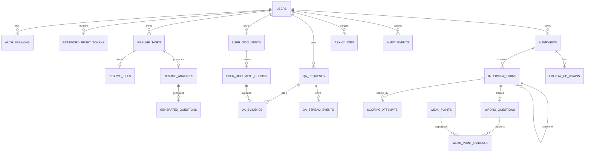

# 技术面试智能体数据模型

| 项目 | 内容 |
| --- | --- |
| 文档版本 | v0.9 |
| 文档状态 | 私有与共享内部资料数据约束已落地 |
| 更新日期 | 2026-10-22 |
| 技术基线 | PostgreSQL 16+、pgvector、SQLAlchemy 2.0 async、Alembic |
| 需求依据 | `docs/requirements.md` v1.5 |

> 本文定义逻辑数据模型、关系、约束和索引入口。`DR-01` 至 `DR-07` 已批准，ADR-0001 至 ADR-0008 已接受；账号、评分公开边界、持久 SSE 游标、任务租约、删除后证据摘要、最小审计和首个用户可见切片的数据约束按本文冻结。

## 1. 建模约定

- 主键统一为 UUID，由服务端生成，不使用可枚举自增 ID 作为公开资源标识。
- 时间统一存储为 `timestamptz`，业务代码使用带时区的 UTC 时间。
- 用户内容、模型输出和内部配置分表或分区存储，避免响应 DTO 误带受保护字段。
- 核心状态使用受限字符串枚举并通过 `CHECK` 或数据库枚举约束；模型生成的自由文本不驱动状态。
- 结构化模型输出以带版本号的 JSONB 保存，关键查询字段单独提升为普通列。
- 删除使用墓碑、删除任务和对象清理状态共同表达。物理删除由保留任务执行。
- 所有涉及用户数据的表都保存 `owner_user_id`，查询必须带所有者条件。
- `created_at`、`updated_at` 为通用列；状态对象可增加 `started_at`、`ended_at`、`deadline_at`。

## 2. 关系总览

## 3. 账号与认证

### 3.1 `users`

| 字段 | 类型 | 约束/说明 |
| --- | --- | --- |
| `id` | UUID | PK |
| `email_normalized` | text | 唯一；应用层完成 trim、Unicode 规范化和小写化 |
| `password_hash` | text | Argon2id；只保存哈希，不保存明文或可逆凭据 |
| `display_name` | text | 可空，限制长度 |
| `status` | enum | `active`、`suspended`、`deletion_pending`、`deleted` |
| `created_at` | timestamptz | 非空 |
| `updated_at` | timestamptz | 非空 |
| `last_login_at` | timestamptz | 可空 |
| `deleted_at` | timestamptz | 可空 |

约束与索引：

- `UNIQUE (email_normalized)`。账号删除后邮箱是否立即复用由后续隐私评审确定；删除流程完成前保留唯一性约束，避免历史会话或审计错误关联。
- `INDEX (status, created_at)` 支持账号清理任务。
- 密码哈希、邮箱和登录凭据不得出现在业务响应和 trace 中。
- 注册只创建 `active` 账号，不创建 `auth_sessions`；登录成功才是会话签发入口。

### 3.2 `auth_sessions`

| 字段 | 类型 | 约束/说明 |
| --- | --- | --- |
| `id` | UUID | PK；内部会话标识，不写入 Cookie |
| `user_id` | UUID | FK -> `users.id`，非空 |
| `token_hash` | text | 唯一；Cookie 保存不透明随机令牌，数据库只保存其哈希 |
| `csrf_token_hash` | text | 非空；只保存 `interview_csrf` verifier 的哈希 |
| `created_at` | timestamptz | 非空 |
| `last_seen_at` | timestamptz | 非空 |
| `expires_at` | timestamptz | 非空 |
| `revoked_at` | timestamptz | 可空 |
| `user_agent_hash` | text | 可空，用于风险诊断，不保存完整 UA |

索引：

- `UNIQUE (token_hash)`。
- `INDEX (user_id, expires_at) WHERE revoked_at IS NULL`。
- 撤销会话必须立即让业务请求验证失败，不能只依赖缓存过期。
- 注册不写入本表；登录、密码重置成功后的重新登录才会创建记录。
- 登录同时生成 `interview_session` 与 `interview_csrf`；`interview_session` 使用 `HttpOnly`，服务端用 `token_hash` 校验它，用 `tokens_equal(token_hash(X-CSRF-Token), csrf_token_hash)` 校验 CSRF verifier。
- `web/` 不读取 `interview_session`；它读取 `interview_csrf` 并把值放入 `X-CSRF-Token`。

### 3.3 `password_reset_tokens`

| 字段 | 类型 | 约束/说明 |
| --- | --- | --- |
| `id` | UUID | PK；内部标识，不写入邮件链接或日志 |
| `user_id` | UUID | FK -> `users.id`，非空 |
| `token_hash` | text | 唯一；数据库不保存邮件中的原始令牌 |
| `created_at` | timestamptz | 非空 |
| `expires_at` | timestamptz | 非空；短时有效，具体时长由配置冻结并纳入测试 |
| `used_at` | timestamptz | 可空；非空表示已成功使用，禁止重放 |
| `revoked_at` | timestamptz | 可空；重新申请、风险处置或账号状态变化时撤销 |

约束与索引：

- `UNIQUE (token_hash)`。
- `INDEX (user_id, expires_at) WHERE used_at IS NULL AND revoked_at IS NULL`。
- 同一用户重新申请重置时，可撤销此前仍有效的令牌，避免多个有效链接并存。
- 确认重置必须在同一事务内完成：校验 `expires_at > now`、`used_at IS NULL`、`revoked_at IS NULL`，更新密码哈希，标记令牌已使用，并撤销该用户全部 `auth_sessions`。
- 并发使用同一令牌时只能有一个事务成功；其余请求返回 `410 reset_token_invalid`。
- 邮件发送失败不得回滚账号创建或影响登录；重置令牌可以保留到过期或被重新申请撤销。

## 4. 简历数据

### 4.1 `resume_tasks`

| 字段 | 类型 | 约束/说明 |
| --- | --- | --- |
| `id` | UUID | PK |
| `owner_user_id` | UUID | FK -> `users.id` |
| `state` | enum | `uploaded`、`extracting`、`analyzing`、`generating_questions`、`completed`、`failed`、`source_deleted` |
| `failure_stage` | enum/text | 可空：`upload`、`extract`、`analyze`、`generate` |
| `error_code` | text | 可空、稳定机器码 |
| `error_message` | text | 可空、脱敏用户文案 |
| `retry_of_task_id` | UUID | 可空、自引用 |
| `analysis_version` | text | 可空 |
| `created_at` | timestamptz | 非空 |
| `started_at` | timestamptz | 可空 |
| `completed_at` | timestamptz | 可空 |
| `expires_at` | timestamptz | 非空，默认创建后 90 天 |
| `deleted_at` | timestamptz | 可空 |

索引：

- `INDEX (owner_user_id, created_at DESC)`。
- `INDEX (state, created_at)` 供 Worker 和清理任务使用。
- `INDEX (expires_at) WHERE deleted_at IS NULL`。

### 4.2 `resume_files`

| 字段 | 类型 | 约束/说明 |
| --- | --- | --- |
| `id` | UUID | PK |
| `resume_task_id` | UUID | FK，唯一 |
| `owner_user_id` | UUID | FK |
| `original_filename` | text | 仅展示，必须转义 |
| `declared_mime` | text | 客户端声明 |
| `detected_mime` | text | 服务端探测 |
| `size_bytes` | bigint | `> 0 AND <= 10485760` |
| `page_count` | integer | `1..10`，提取后回填 |
| `sha256` | text | 校验值 |
| `object_key` | text | 唯一，不返回客户端 |
| `storage_state` | enum | `stored`、`delete_pending`、`deleted`、`delete_failed` |
| `retention_expires_at` | timestamptz | 默认创建后 30 天 |
| `created_at` | timestamptz | 非空 |
| `deleted_at` | timestamptz | 可空 |

约束与索引：

- `CHECK (size_bytes <= 10485760)`。
- `CHECK (page_count IS NULL OR page_count <= 10)`。
- `UNIQUE (object_key)`。
- `INDEX (owner_user_id, retention_expires_at)`。
- 不保存公开 URL。`resume_files` 删除后，`resume_tasks` 进入 `source_deleted`，分析与题目保留。

### 4.3 `resume_texts`

| 字段 | 类型 | 约束/说明 |
| --- | --- | --- |
| `id` | UUID | PK |
| `resume_task_id` | UUID | FK，唯一 |
| `owner_user_id` | UUID | FK |
| `extracted_text` | text | 加密或受控字段；不作为日志 |
| `text_hash` | text | 去重和完整性 |
| `extractor_version` | text | 解析器版本 |
| `page_map` | jsonb | 页到字符区间映射 |
| `created_at` | timestamptz | 非空 |
| `expires_at` | timestamptz | 非空 |
| `deleted_at` | timestamptz | 可空 |

提取文本不得直接进入 Prompt 日志或错误响应。

### 4.4 `resume_analyses`

| 字段 | 类型 | 约束/说明 |
| --- | --- | --- |
| `id` | UUID | PK |
| `resume_task_id` | UUID | FK，唯一 |
| `owner_user_id` | UUID | FK |
| `schema_version` | text | 非空 |
| `analysis_version` | text | 非空 |
| `skills` | jsonb | 技能和证据 |
| `projects` | jsonb | 项目、职责、成果 |
| `evidence` | jsonb | 数据结构固定为脱敏摘要、能力标签和稳定证据 ID |
| `unverified_items` | jsonb | 无证据项 |
| `gaps` | jsonb | 潜在缺口 |
| `model_name` | text | 或模型档位映射 |
| `prompt_version` | text | 非空 |
| `created_at` | timestamptz | 非空 |
| `expires_at` | timestamptz | 默认 90 天 |
| `deleted_at` | timestamptz | 可空 |

索引：

- `UNIQUE (resume_task_id)`。
- `INDEX (owner_user_id, created_at DESC)`。
- JSONB 中关键字段在设计迁移时用生成列或普通列提升，不依赖全表 JSON 查询。

证据约束：

- `evidence.summary` 每条最多 200 个字符，并禁止保存原文引用、页码、章节、字符区间、文件名或可恢复正文的上下文。
- 原始简历删除时，证据在同一事务内重写为脱敏摘要并写入 `source_state = source_deleted`；无法安全脱敏的证据必须删除。
- `resume_texts.extracted_text`、`page_map` 和对象存储内容不得作为删除后证据快照的来源继续保留。

### 4.5 `generated_questions`

| 字段 | 类型 | 约束/说明 |
| --- | --- | --- |
| `id` | UUID | PK |
| `owner_user_id` | UUID | FK |
| `resume_analysis_id` | UUID | FK |
| `sequence` | integer | `1..10` |
| `question_text` | text | 非空 |
| `category` | text | 技能/项目/工程等 |
| `difficulty` | enum | `easy`、`medium`、`hard` |
| `topic_key` | text | 主题稳定键 |
| `assessment_points` | jsonb | 考察点 |
| `reference_answer` | text | 受保护字段 |
| `scoring_rubric` | jsonb | 受保护字段 |
| `evidence_refs` | jsonb | 来源证据摘要或 ID |
| `created_at` | timestamptz | 非空 |
| `deleted_at` | timestamptz | 可空 |

约束与索引：

- `UNIQUE (resume_analysis_id, sequence)`。
- `CHECK (difficulty IN ('easy','medium','hard'))`。
- `INDEX (resume_analysis_id, difficulty)`。
- 公开题目 DTO 不包含 `reference_answer` 和 `scoring_rubric`。
- `evidence_refs` 只允许稳定证据 ID、脱敏摘要、能力标签和来源状态；不得保存原文位置、文件名或可拼接上下文。

## 5. 知识源与检索

### 5.1 `knowledge_sources`

| 字段 | 类型 | 约束/说明 |
| --- | --- | --- |
| `id` | UUID | PK |
| `source_type` | enum | `official_doc`、`question_bank` |
| `title` | text | 非空 |
| `source_uri` | text | 内部管理员配置，不返回任意用户 |
| `direction` | enum/null | `backend`、`frontend`、`fullstack` 或共享 |
| `allowlisted` | boolean | 默认 false |
| `created_at` | timestamptz | 非空 |

### 5.2 `knowledge_source_versions`

| 字段 | 类型 | 约束/说明 |
| --- | --- | --- |
| `id` | UUID | PK |
| `source_id` | UUID | FK |
| `version_label` | text | 非空 |
| `content_hash` | text | 唯一 |
| `published_at` | timestamptz | 非空 |
| `status` | enum | `draft`、`published`、`retired` |

约束：

- `UNIQUE (source_id, version_label)`。
- 历史问答和证据固定版本 ID，不跟随最新版本更新。

### 5.3 `qa_requests`

| 字段 | 类型 | 约束/说明 |
| --- | --- | --- |
| `id` | UUID | PK |
| `owner_user_id` | UUID | FK |
| `question_text` | text | 非空 |
| `state` | enum | `created`、`retrieving`、`answering`、`completed`、`failed` |
| `answer_json` | jsonb | 最终结构化答案 |
| `last_event_seq` | integer | 最后持久化的事件序号，默认 0 |
| `evidence_status` | enum | `supported`、`model_knowledge`、`insufficient` |
| `extended_questions` | jsonb | 建议问题 |
| `domain_label` | text | 可空/P1 |
| `model_name` | text | 非空 |
| `prompt_version` | text | 非空 |
| `saved` | boolean | 默认 false |
| `created_at` | timestamptz | 非空 |
| `completed_at` | timestamptz | 可空 |
| `expires_at` | timestamptz | 非空 |
| `deleted_at` | timestamptz | 可空 |

索引：

- `INDEX (owner_user_id, created_at DESC)`。
- `INDEX (state, created_at)`。
- 只保存当前用户可访问的问题和答案，历史保存时冻结知识源版本。

### 5.4 `qa_stream_events`

| 字段 | 类型 | 约束/说明 |
| --- | --- | --- |
| `qa_request_id` | UUID | FK -> `qa_requests.id`，复合主键之一 |
| `seq` | integer | 请求内单调递增序号，从 1 开始，复合主键之一 |
| `event_type` | enum | `started`、`delta`、`evidence`、`completed`、`error` |
| `payload_json` | jsonb | 事件数据；不含其他用户数据或未脱敏内部内容 |
| `created_at` | timestamptz | 非空 |

约束与索引：

- `PRIMARY KEY (qa_request_id, seq)`，同一请求的事件序号不可重复或回退。
- `UNIQUE (qa_request_id) WHERE event_type = 'completed'`。
- `UNIQUE (qa_request_id) WHERE event_type = 'error'`。
- `CHECK (seq > 0)`；写事件与更新 `qa_requests.last_event_seq` 在同一事务中完成。
- 事件和终态以 PostgreSQL 为事实来源；Redis 只允许缓存，不得作为 `Last-Event-ID` 或最终答案的唯一来源。
- `completed` 必须先有持久化 `answer_json`；重连只补发 `seq > cursor` 的事件，不重新执行检索或模型调用。
- 事件按请求保留期限清理，不能脱离 `qa_requests` 的所有权校验单独访问。

### 5.5 `qa_evidence`

| 字段 | 类型 | 约束/说明 |
| --- | --- | --- |
| `id` | UUID | PK |
| `qa_request_id` | UUID | FK |
| `knowledge_source_version_id` | UUID | FK，可空 |
| `user_document_chunk_id` | UUID | FK -> `user_document_chunks.id`，可空；来源删除时 `SET NULL` |
| `source_kind` | enum | `system`、`user_document`、`shared_document`，默认 `system` |
| `shared_document_chunk_id` | UUID | FK -> `shared_document_chunks.id`，可空；来源删除时 `SET NULL` |
| `source_title` | text | 快照 |
| `section_path` | text | 快照 |
| `snippet` | text | 脱敏摘要，`CHECK (char_length(snippet) <= 200)` |
| `relevance_score` | numeric | `0..1` |
| `position` | jsonb | 删除前内部定位；来源删除后必须清空 |
| `source_state` | enum | `available`、`source_deleted` |
| `created_at` | timestamptz | 非空 |

约束与索引：

- `INDEX (qa_request_id)`。
- 证据摘要不是知识库原文的完整副本。
- 来源删除后 `snippet` 仍不得超过 200 个字符，`position` 必须为 `NULL`，不得再保存文件名、原文引用或可恢复正文的上下文。
- 删除和保留策略仍须与知识源许可协调，不能因用户需求批准而突破外部许可。

### 5.6 `user_documents`

每个登录用户拥有独立资料域，`owner_user_id` 是强制隔离键。系统 allowlist 仍只存在于 `knowledge_sources`，个人资料不得写入该表。

| 字段 | 类型 | 约束/说明 |
| --- | --- | --- |
| `id` | UUID | PK |
| `owner_user_id` | UUID | FK -> `users.id`，非空 |
| `title` | text | 非空，展示标题 |
| `original_filename` | text | 非空，仅 owner 可见 |
| `detected_mime` | text | 非空 |
| `size_bytes` | bigint | `1..10485760` |
| `sha256` | text | 文件内容哈希 |
| `object_key` | text | 唯一私有存储键，不返回 API |
| `state` | enum | `uploaded`、`processing`、`ready`、`failed`、`deleted` |
| `failure_code` | text | 可空 |
| `error_message` | text | 可空，仅中性原因 |
| `chunk_count` | integer | 默认 0 |
| `index_version` | text | 当前为 `rag-v1` |
| `embedding_model` | text | 成功索引时固定模型名 |
| `embedding_dimensions` | integer | 成功索引时固定为 1024 |
| `deletion_state` | text | `pending`、`deleted`、`failed`，用于异步对象清理 |
| `idempotency_key` | text | 服务端哈希后的幂等键 |
| `request_fingerprint` | text | 上传内容指纹 |
| `created_at` / `updated_at` | timestamptz | 非空 |
| `completed_at` / `deleted_at` | timestamptz | 可空 |
| `retention_expires_at` | timestamptz | 非空，默认创建后 90 天 |

约束与索引：

- `UNIQUE (owner_user_id, sha256) WHERE deleted_at IS NULL`。
- `UNIQUE (owner_user_id, idempotency_key) WHERE idempotency_key IS NOT NULL`。
- `INDEX (owner_user_id, created_at DESC)` 和 `INDEX (owner_user_id, state, updated_at)`。
- 检索只允许 `state = 'ready' AND deleted_at IS NULL AND retention_expires_at > now()`。

### 5.7 `user_document_chunks`

| 字段 | 类型 | 约束/说明 |
| --- | --- | --- |
| `id` | UUID | PK |
| `document_id` | UUID | FK -> `user_documents.id`，级联删除 |
| `owner_user_id` | UUID | FK -> `users.id`，非空 |
| `chunk_index` | integer | 从 0 开始 |
| `section_path` | text | 稳定章节路径 |
| `content` | text | 规范化分块正文，不直接返回公开 DTO |
| `content_hash` | text | 分块哈希 |
| `search_text` | text | 中文双字切分和英文词项组成的词法检索文本 |
| `search_vector` | tsvector | 由 `search_text` 生成，GIN 索引 |
| `token_count` | integer | 非空 |
| `embedding` | `vector(1024)` | `mxbai-embed-large:latest` 向量，非空 |
| `created_at` | timestamptz | 非空 |

约束与索引：

- `UNIQUE (document_id, chunk_index)`。
- `INDEX (owner_user_id, document_id)`。
- `GIN (search_vector)` 支持 PostgreSQL `ts_rank_cd` 的 BM25 风格词法召回。
- `HNSW (embedding vector_cosine_ops)` 支持 pgvector 余弦候选召回。
- 迁移显式执行 `CREATE EXTENSION IF NOT EXISTS vector`，不调用 Ollama。
- 向量召回与词法召回都必须在查询中附加 owner 和可检索状态过滤；随后按 owner-safe 候选做 RRF 融合。

### 5.8 `users.role`

| 字段 | 类型 | 约束/说明 |
| --- | --- | --- |
| `role` | text | 非空，默认 `user`；只允许 `user`、`admin` |

角色只用于共享资料管理权限，不扩大个人资料 owner 范围。首个管理员通过运维 CLI 任命。

### 5.9 `shared_documents`

共享资料没有 `owner_user_id`，其可见范围是所有 active 登录用户。

| 字段 | 类型 | 约束/说明 |
| --- | --- | --- |
| `id` | UUID | PK |
| `created_by_user_id` | UUID | FK -> `users.id`，可空；账号删除时 `SET NULL` |
| `title` / `original_filename` / `detected_mime` | text | 展示和检测元数据 |
| `size_bytes` | bigint | `1..10485760` |
| `sha256` | text | 活跃资料全表唯一 |
| `object_key` | text | 唯一私有存储键 |
| `state` | enum | `uploaded`、`processing`、`ready`、`failed`、`deleted` |
| `failure_code` / `error_message` | text | 可空 |
| `chunk_count` | integer | 默认 0 |
| `index_version` / `embedding_model` / `embedding_dimensions` | | 索引元数据 |
| `idempotency_key` / `request_fingerprint` | text | 幂等元数据 |
| `deletion_state` | text | `pending`、`deleted`、`failed` |
| `created_at` / `updated_at` | timestamptz | 非空 |
| `completed_at` / `deleted_at` | timestamptz | 可空 |

约束与索引：

- 活跃资料的 `sha256` 全表唯一；
- 非空 `idempotency_key` 全表唯一；
- 创建者必须为 admin，由迁移中的数据库触发器校验；
- 共享资料不做 90 天自动过期，管理员显式删除前长期可用。

### 5.10 `shared_document_chunks`

| 字段 | 类型 | 约束/说明 |
| --- | --- | --- |
| `id` | UUID | PK |
| `document_id` | UUID | FK -> `shared_documents.id`，级联删除 |
| `chunk_index` | integer | 文件内顺序 |
| `section_path` / `content` / `content_hash` / `search_text` | text | 检索正文和稳定定位 |
| `search_vector` | tsvector | 由 `search_text` 生成，GIN 索引 |
| `token_count` | integer | 非空 |
| `embedding` | `vector(1024)` | 非空，HNSW cosine 索引 |
| `created_at` | timestamptz | 非空 |

约束与索引：

- `UNIQUE (document_id, chunk_index)`；
- `GIN (search_vector)`；
- `HNSW (embedding vector_cosine_ops)`；
- 检索只允许 `state='ready' AND deleted_at IS NULL`。

## 6. 模拟面试

### 6.1 `interviews`

| 字段 | 类型 | 约束/说明 |
| --- | --- | --- |
| `id` | UUID | PK |
| `owner_user_id` | UUID | FK |
| `direction` | enum | `backend`、`frontend`、`fullstack` |
| `difficulty_profile` | jsonb | 创建时冻结的分布 |
| `topic_keys` | jsonb | 用户可选主题；受配置校验 |
| `state` | enum | `created`、`in_progress`、`completed`、`cancelled`、`timed_out`、`failed` |
| `main_question_count` | integer | 固定 5 |
| `total_token_budget` | integer | 非空，默认配置 |
| `total_tokens_used` | integer | 默认 0 |
| `deadline_at` | timestamptz | 进入 `in_progress` 时写入，服务端 40 分钟 |
| `started_at` | timestamptz | 可空 |
| `ended_at` | timestamptz | 可空 |
| `end_reason` | text | 可空、稳定枚举 |
| `feedback_unlocked_at` | timestamptz | 整场终态且所有已接收轮次离开 `scoring` 后写入 |
| `blueprint_version` | text | 非空 |
| `scoring_version` | text | 非空 |
| `created_at` | timestamptz | 非空 |
| `expires_at` | timestamptz | 非空 |
| `deleted_at` | timestamptz | 可空 |

约束与索引：

- `CHECK (main_question_count = 5)`。
- `INDEX (owner_user_id, created_at DESC)`。
- `INDEX (state, deadline_at)` 供超时扫描。
- `deadline_at` 在进入 `in_progress` 时由数据库时间写入，固定为 `database_now + interval '40 minutes'`；恢复、客户端时间和服务端应用时钟都不能修改或延长。
- 截止有效条件为 `database_now < deadline_at`；相等即已截止。`client_submitted_at` 只用于诊断。
- `end_reason` 只允许 `user_ended_interview`、`deadline_reached`、`all_questions_completed`、`unrecoverable_error` 等稳定枚举；P0 用户主动提前结束整场不写入该字段。
- 当前追问链结束不修改 `ended_at` 或 `end_reason`。

### 6.2 `interview_turns`

| 字段 | 类型 | 约束/说明 |
| --- | --- | --- |
| `id` | UUID | PK |
| `interview_id` | UUID | FK |
| `owner_user_id` | UUID | FK |
| `parent_turn_id` | UUID | 可空、自引用 |
| `root_turn_id` | UUID | 根问题自引用或主问题 ID |
| `turn_type` | enum | `main`、`follow_up` |
| `depth` | integer | 主问题 0，追问 1..2 |
| `state` | enum | `pending`、`awaiting_answer`、`scoring`、`passed`、`failed`、`scoring_failed`、`branch_completed`、`skipped`、`unanswered`、`cancelled` |
| `end_reason` | enum | 可空：`user_skipped`、`user_ended_branch`、`branch_budget_exhausted`、`follow_up_failed`、`deadline_reached` |
| `sequence` | integer | 面试内顺序 |
| `question_text` | text | 非空 |
| `reference_answer` | text | 受保护字段 |
| `scoring_rubric` | jsonb | 受保护字段 |
| `topic_key` | text | 非空 |
| `difficulty` | enum | `easy`、`medium`、`hard` |
| `question_snapshot` | jsonb | 出题时的版本化快照 |
| `submitted_at` | timestamptz | 回答首次接收时间 |
| `answer_text` | text | 可空、敏感字段 |
| `idempotency_key` | text | 可空，提交时写入 |
| `score_total` | numeric | 可空，内部字段 |
| `score_breakdown` | jsonb | 可空，内部字段 |
| `score_band` | enum | 可空：`below_70`、`70_84`、`85_plus` |
| `critical_error` | boolean | 可空 |
| `score_version` | text | 可空 |
| `created_at` | timestamptz | 非空 |
| `updated_at` | timestamptz | 非空 |

约束与索引：

- `CHECK (depth BETWEEN 0 AND 2)`。
- 同一父轮次的直接子轮次最多一个，单链模型通过唯一约束或服务层锁保证。
- `UNIQUE (interview_id, sequence)`。
- `UNIQUE (interview_id, idempotency_key) WHERE idempotency_key IS NOT NULL`。
- `CHECK ((turn_type = 'main' AND depth = 0) OR (turn_type = 'follow_up' AND depth BETWEEN 1 AND 2))`。
- `INDEX (interview_id, parent_turn_id, sequence)`。
- `INDEX (owner_user_id, interview_id)`。
- 评分字段与用户可见 DTO 分离；结束前不得由公开查询返回。
- 已接收轮次进入 `scoring` 后，永久评分失败必须转为 `scoring_failed` 并保留可解释错误，不能无限停留在 `scoring`。

### 6.3 `follow_up_chains`

| 字段 | 类型 | 约束/说明 |
| --- | --- | --- |
| `id` | UUID | PK |
| `interview_id` | UUID | FK |
| `root_turn_id` | UUID | FK -> `interview_turns.id` |
| `current_turn_id` | UUID | 可空 |
| `depth_used` | integer | 默认 0 |
| `answer_count` | integer | 默认 0 |
| `max_depth` | integer | 默认 2 |
| `max_answers` | integer | 默认 3 |
| `tokens_used` | integer | 默认 0 |
| `token_budget` | integer | 非空 |
| `state` | enum | 见需求 8.4 |
| `termination_reason` | text | 可空 |
| `updated_at` | timestamptz | 非空 |

约束：

- `CHECK (depth_used <= max_depth)`。
- `CHECK (answer_count <= max_answers)`。
- `CHECK (tokens_used <= token_budget)`。
- `UNIQUE (interview_id, root_turn_id)`。
- `INDEX (state, updated_at)`。
- `termination_reason` 与轮次 `end_reason` 使用同一稳定枚举；跳过、结束追问链、整场截止和预算耗尽不得共用一个值。
- 结束当前追问链只更新当前链和轮次，不取消未展示的主问题，不修改面试 `ended_at`。

### 6.4 `scoring_attempts`

| 字段 | 类型 | 约束/说明 |
| --- | --- | --- |
| `id` | UUID | PK |
| `turn_id` | UUID | FK |
| `attempt_no` | integer | 从 1 开始 |
| `state` | enum | `pending`、`running`、`succeeded`、`failed`、`timed_out` |
| `model_name` | text | 非空 |
| `prompt_version` | text | 非空 |
| `raw_output` | jsonb | 受保护，不必长期保留 |
| `validated_output` | jsonb | 可空 |
| `error_code` | text | 可空 |
| `started_at` | timestamptz | 可空 |
| `finished_at` | timestamptz | 可空 |
| `created_at` | timestamptz | 非空 |

约束：

- `UNIQUE (turn_id, attempt_no)`。
- 同一轮次只允许一个成功评分尝试。
- 评分失败不触发错题写入。

## 7. 报告、错题和薄弱点

### 7.1 `interview_reports`

| 字段 | 类型 | 约束/说明 |
| --- | --- | --- |
| `id` | UUID | PK |
| `interview_id` | UUID | FK，唯一 |
| `owner_user_id` | UUID | FK |
| `summary_json` | jsonb | 聚合结果 |
| `main_question_count` | integer | 5 |
| `follow_up_count` | integer | 统计值 |
| `passed_count` | integer | 统计值 |
| `failed_count` | integer | 统计值 |
| `topic_performance` | jsonb | 主题表现 |
| `report_version` | text | 非空 |
| `generated_at` | timestamptz | 非空 |
| `deleted_at` | timestamptz | 可空 |

报告生成必须在面试终态后执行，未完成的轮次标记为 `unanswered`，不写成错题。

### 7.2 `wrong_questions`

| 字段 | 类型 | 约束/说明 |
| --- | --- | --- |
| `id` | UUID | PK |
| `owner_user_id` | UUID | FK |
| `interview_id` | UUID | FK |
| `turn_id` | UUID | FK，唯一 |
| `parent_turn_id` | UUID | 可空 |
| `question_text` | text | 快照 |
| `answer_text` | text | 快照，敏感 |
| `reference_answer` | text | 受保护 |
| `score_breakdown` | jsonb | 快照 |
| `loss_reasons` | jsonb | 失分原因 |
| `topic_key` | text | 非空 |
| `difficulty` | enum | 非空 |
| `state` | enum | `active`、`reviewing`、`mastered`、`archived` |
| `created_at` | timestamptz | 非空 |
| `updated_at` | timestamptz | 非空 |
| `expires_at` | timestamptz | 非空 |
| `deleted_at` | timestamptz | 可空 |

约束与索引：

- `UNIQUE (turn_id)` 保证幂等。
- `INDEX (owner_user_id, state, created_at DESC)`。
- `INDEX (owner_user_id, topic_key, difficulty)`。

### 7.3 `weak_points`

| 字段 | 类型 | 约束/说明 |
| --- | --- | --- |
| `id` | UUID | PK |
| `owner_user_id` | UUID | FK |
| `topic_key` | text | 聚合键 |
| `title` | text | 用户可见摘要 |
| `severity` | numeric | 排序依据 |
| `failure_count` | integer | 来源失败次数 |
| `last_failure_at` | timestamptz | 最近失败时间 |
| `review_advice` | jsonb | 可执行建议 |
| `state` | enum | `identified`、`reviewing`、`improved`、`archived` |
| `created_at` | timestamptz | 非空 |
| `updated_at` | timestamptz | 非空 |
| `deleted_at` | timestamptz | 可空 |

约束：

- `UNIQUE (owner_user_id, topic_key) WHERE deleted_at IS NULL`。
- `INDEX (owner_user_id, severity DESC, failure_count DESC, last_failure_at DESC)`。

### 7.4 `weak_point_evidence`

| 字段 | 类型 | 约束/说明 |
| --- | --- | --- |
| `weak_point_id` | UUID | FK |
| `wrong_question_id` | UUID | FK |
| `turn_id` | UUID | FK |
| `loss_reason_hash` | text | 稳定性 |
| `created_at` | timestamptz | 非空 |

约束：

- `UNIQUE (weak_point_id, wrong_question_id, turn_id, loss_reason_hash)`。
- 删除错题后弱点的来源关系和展示规则按隐私策略处理，不删除底层审计事实。

## 8. 异步任务与审计

### 8.1 `data_deletion_requests`

| 字段 | 类型 | 约束/说明 |
| --- | --- | --- |
| `id` | UUID | PK |
| `owner_user_id` | UUID | FK -> `users.id` |
| `idempotency_key` | text | 调用方幂等键哈希 |
| `request_fingerprint` | text | 固定删除范围指纹 |
| `state` | enum | `requested`、`deleting`、`completed`、`failed` |
| `scope` | jsonb | 固定范围枚举列表 |
| `result` | jsonb | 可空，数量摘要，不含正文 |
| `error_code` | text | 可空、稳定错误码 |
| `created_at` | timestamptz | 非空 |
| `updated_at` | timestamptz | 非空 |
| `completed_at` | timestamptz | 可空 |

约束：

- `UNIQUE (owner_user_id, idempotency_key)`。
- `INDEX (owner_user_id, created_at)`、`INDEX (state, updated_at)`。
- 删除请求只保存范围和中性结果摘要，不保存用户内容、对象键或原始资源 ID。

### 8.2 `async_jobs`

| 字段 | 类型 | 约束/说明 |
| --- | --- | --- |
| `id` | UUID | PK |
| `owner_user_id` | UUID | 可空，内部任务可空 |
| `job_type` | enum | 简历、问答、面试评分、`delete_data`、`delete_account_data`、`retention_cleanup` 等固定枚举 |
| `resource_type` | text | 业务对象类型 |
| `resource_id` | UUID | 业务对象 ID |
| `idempotency_key` | text | 唯一 |
| `state` | enum | `queued`、`leased`、`succeeded`、`failed`、`dead_letter`、`cancelled` |
| `attempt_count` | integer | 默认 0 |
| `max_attempts` | integer | 非空 |
| `lease_owner` | text | 当前租约持有者，可空 |
| `fencing_token` | bigint | 单调递增，默认 0；每次领取递增 |
| `lease_until` | timestamptz | 可空 |
| `next_run_at` | timestamptz | 非空 |
| `error_code` | text | 可空 |
| `error_detail` | text | 脱敏 |
| `created_at` | timestamptz | 非空 |
| `updated_at` | timestamptz | 非空 |

约束与索引：

- `UNIQUE (idempotency_key)`。
- `INDEX (state, next_run_at)`。
- `INDEX (lease_until) WHERE state = 'leased'`。
- 领取事务使用 `FOR UPDATE SKIP LOCKED`，同时设置 `lease_owner`、递增 `fencing_token` 和 `lease_until`。
- 成功、失败和续期写入必须匹配当前 `lease_owner` 与 `fencing_token`；条件不匹配时拒绝写入，旧 Worker 不得覆盖新租约。
- 幂等键和业务唯一约束负责最终防重；租约与 fencing token 负责并发执行隔离。

### 8.3 `audit_events`

| 字段 | 类型 | 约束/说明 |
| --- | --- | --- |
| `id` | UUID | PK |
| `action` | text | 稳定枚举 |
| `resource_type` | enum | 内部资源类型枚举，不含用户内容 |
| `resource_id_hash` | text | 哈希化资源 ID |
| `result` | enum | `success`、`failure`、`denied` |
| `request_id` | text | 非空 |
| `created_at` | timestamptz | 非空 |
| `expires_at` | timestamptz | 固定为 `created_at + interval '365 days'` |

审计表禁止保存用户 ID 原值、简历正文、完整回答、参考答案、证据原文、登录凭据或可逆个人标识。字段采用严格 allowlist，不提供通用 metadata JSONB，防止业务正文经扩展字段进入审计。

约束与索引：

- `CHECK (expires_at = created_at + interval '365 days')`。
- `INDEX (expires_at)` 供清理任务使用。
- `UNIQUE (request_id, action, resource_type, resource_id_hash)` 防止同一操作重放产生重复审计事实。
- `actor_user_id` 不进入审计保存结构；如确需关联操作者，只使用不可逆哈希化标识，且不得与业务正文关联。
- 到期审计由 `retention_cleanup` 删除，不允许继续保留可关联的原始元数据。

## 9. 迁移与初始化

Alembic 首次迁移应包含：

1. 枚举和扩展。
2. 用户、会话、密码重置令牌和权限基础表。
3. 简历文件、文本、分析、题目。
4. 知识源版本、QA 请求和证据。
5. 面试、轮次、追问链和评分尝试。
6. 报告、错题、薄弱点及证据关联。
7. 异步任务和审计。
8. 唯一约束、外键、部分索引和清理索引。

迁移规则：

- 每个迁移可重复执行或明确不可重复的原因。
- 不把敏感数据迁移到日志或临时明文文件。
- 变更索引和约束时同时给出回滚方案。
- 生产迁移使用可兼容的 expand/contract 方式，不在同一次发布中立即删除旧列。

## 10. 已批准决策对模型的影响

| 决策 | 受影响的表/字段 | 已冻结规则 |
| --- | --- | --- |
| `DR-03` | 面试状态事件和查询 DTO | 只暴露中性流程、已提交轮次、完成数、剩余题数和时间 |
| `DR-04` | `interviews.end_reason`、轮次和追问链结束原因 | P0 只结束当前追问链；跳过、结束链和结束整场原因分开 |
| `DR-05` | 分析证据、报告快照、QA 证据 | 摘要不超过 200 字符，来源删除后清除位置、文件名和上下文 |
| `DR-06` | `audit_events` | 只保存最小白名单字段，固定保留 365 天 |
| `DR-07` | `auth_sessions.csrf_token_hash`、历史分页游标 | `csrf_token_hash` 只保存 verifier 哈希；历史接口使用稳定游标返回 `{items, next_cursor}` |
| `DR-08` | `user_documents`、`user_document_chunks`、`qa_evidence` | 个人资料按 owner 隔离，不进入 allowlist；删除后停止检索并标记历史证据来源已删除 |
| `DR-09` | `users.role`、`shared_documents`、`shared_document_chunks`、`qa_evidence` | 管理员上传和删除共享资料；所有 active 用户可读并参与检索；管理员不能读取他人个人资料 |

ADR 对模型的影响：

- ADR-0003：`interviews.deadline_at` 使用数据库时间，固定 40 分钟，服务端判断边界。
- ADR-0006：新增 `qa_stream_events` 和 `qa_requests.last_event_seq`，事件游标和终态从 PostgreSQL 重建。
- ADR-0007：`async_jobs` 增加 `lease_owner`、`fencing_token`，所有租约写入执行 fencing 校验。
- ADR-0008：`feedback_unlocked_at` 的解锁条件是终态且所有已接收轮次离开 `scoring`；永久失败进入 `scoring_failed`，报告标记不完整评分。
- ADR-0009：新增 `vector(1024)`、HNSW、`tsvector`/GIN、`search_text`、私有对象键和来源类型字段；历史证据来自系统资料或用户资料，删除资料时保留摘要但清除后续检索资格。
- ADR-0010：新增 `users.role`、独立共享资料表和共享分块表，证据增加 `shared_document_chunk_id`，管理员账号删除只置空共享资料创建者。

`DR-01` 与 `DR-02` 已冻结：评分字段可以持久化在内部表，但提交响应和报告 DTO 必须按状态裁剪。进行中不返回受保护字段，终态且全部已接收轮次评分完成后才解锁。

## 11. 版本记录

| 版本 | 日期 | 变更 |
| --- | --- | --- |
| v0.1 | 2026-10-17 | 建立核心数据关系、表结构、约束、索引和迁移入口 |
| v0.2 | 2026-10-17 | 冻结邮箱密码、服务端会话和一次性重置令牌模型；移除 DR-01/DR-02 待审批状态 |
| v0.3 | 2026-10-17 | 同步需求 v1.4 的注册不签发会话与邮件故障隔离边界 |
| v0.4 | 2026-10-17 | 按 DR-03 至 DR-06 冻结 200 字符证据摘要、来源删除定位清理、结束原因分离和 365 天最小审计模型 |
| v0.5 | 2026-10-17 | 接受 ADR-0003、ADR-0006、ADR-0007、ADR-0008；增加持久 SSE 事件模型、数据库时钟截止、任务租约 fencing 字段和受保护反馈终态约束 |
| v0.6 | 2026-10-17 | 落实 `DR-07` 方案 A：`auth_sessions` 增加 `csrf_token_hash`，`interview_session`/`interview_csrf` 双 Cookie，历史使用 `{items, next_cursor}` 稳定游标分页 |
| v0.7 | 2026-10-18 | 增加 `data_deletion_requests`、`delete_account_data`、`retention_cleanup`、隐私删除幂等和 365 天审计清理数据约束 |
| v0.8 | 2026-10-22 | 增加私有 `user_documents`、`user_document_chunks`、pgvector HNSW、tsvector GIN、owner 隔离、90 天保留和证据来源约束 |
| v0.9 | 2026-10-22 | 增加管理员角色、共享资料表、共享分块表、共享证据来源和创建者生命周期约束 |
