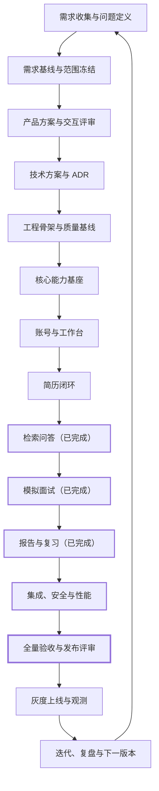

# 技术面试智能体开发全流程

| 项目 | 内容 |
| --- | --- |
| 文档版本 | v3.7 |
| 文档状态 | 流程基线 |
| 更新日期 | 2026-10-20 |
| 需求依据 | `docs/requirements.md` v1.5 |
| 产品依据 | `docs/product-design.md` v1.5 |
| 技术依据 | `docs/technical-design.md` v0.21 |
| 审批依据 | `docs/decision-register.md` v0.8 |

> 本文是项目从需求收集到上线迭代的快速入口。流程覆盖交付顺序、责任边界、阶段产物和门禁；具体业务规则以需求基线为准，页面与交互以产品方案为准。

## 快速定位

- [当前状态](#当前状态)
- [流程总览](#流程总览)
- [阶段说明](#阶段说明)
- [阶段门禁](#阶段门禁)
- [MVP 开发切片](#mvp-开发切片)
- [纵向开发闭环](#纵向开发闭环)
- [完成定义](#完成定义)
- [上线前检查](#上线前检查)
- [上线与迭代](#上线与迭代)
- [文档与决策追踪](#文档与决策追踪)
- [当前阻塞与下一步](#当前阻塞与下一步)

## 当前状态

| 项目 | 状态 |
| --- | --- |
| 需求基线 | `v1.5` 已确认，见[需求文档](./requirements.md) |
| 产品方案 | `v1.5` 已确认，见[产品方案设计](./product-design.md) |
| 技术基线 | 技术设计 v0.21，ADR-0001 至 ADR-0008 全部接受 |
| 工程骨架 | 已完成，应用、迁移、质量门禁和首次 eval 基线均已验证 |
| 需求审批 | `DR-01` 至 `DR-07` 已批准；`DR-07` 选择方案 A |
| 当前阶段 | 发布候选（release candidate）；P0 业务切片、质量门禁、G4A 行为矩阵、本地恢复/回滚和告警送达演练已通过；生产复核与发布批准待完成 |
| 下一步 | 冻结发布 SHA，完成生产配置、灾备、邮件、OSS 与通知渠道复核，取得发布批准后执行灰度上线 |

## 流程总览



## 阶段说明

### 1. 需求收集与问题定义

目标：确认用户、问题、价值和 MVP 边界。

主要工作：

- 访谈目标求职者，收集简历出题、技术问答、模拟面试的真实使用场景。
- 区分用户问题、产品解法、业务规则和技术实现。
- 识别范围外能力，包括泛化闲聊、模型训练和自动外部写操作。
- 定义可量化的成功指标、性能目标和验收口径。

交付物：

- 用户故事、功能需求、状态模型和验收场景。
- 已确认决策与未决问题的独立记录。

进入下一阶段的条件：P0 范围、核心规则、目标方向和指标口径一致。

### 2. 需求基线与范围冻结

目标：让需求成为可评审、可追踪、可变更控制的基线。

主要工作：

- 冻结 P0、P1、P2 边界。
- 确认身份、文件限制、评分权重、分数分段、追问预算、反馈解锁和检索来源。
- 建立需求编号、验收编号和产品模块之间的追踪关系。
- 对需求变更规定版本升级和重新验收范围。

交付物：

- [需求文档](./requirements.md) v1.5。
- 已确认决策基线 `D-01` 至 `D-37`。
- P0 验收场景 `AC-01` 至 `AC-45`。

进入下一阶段的条件：不存在会改变表结构、状态机或接口协议的需求空白。

### 3. 产品方案与交互评审

目标：把需求转成用户能理解、研发能实现的页面和行为。

主要工作：

- 定义信息架构、页面清单、用户旅程和权限边界。
- 覆盖空状态、加载、成功、可重试失败、不可恢复失败、权限拒绝和已删除状态。
- 确认进行中面试的受保护内容边界、流式回答交互和追问控制方式。
- `PD-01`、`PD-03`、`PD-04`、`PD-09`、`PD-10` 已写入需求基线；`PD-07` 与 D-12 重复，直接关闭。
- 原 `PD-02`、`PD-05`、`PD-06`、`PD-08` 已由 `DR-03` 至 `DR-06` 关闭；首个用户可见切片的工程和页面边界登记为 `DR-07`，已按方案 A 批准。

交付物：

- [产品方案设计](./product-design.md) v1.5 及以上版本。
- 页面原型或交互稿。
- 已确认决策与关闭记录。

进入下一阶段的条件：主流程、异常流程、恢复流程和受保护内容展示规则均已确认。

### 4. 技术方案与 ADR（已完成）

目标：把需求与产品规则落到稳定的数据、状态、接口和安全边界。

主要工作：

- 按 `AGENTS.md` 设计 `api -> agent -> tools -> llm` 分层和模块职责。
- 定义数据库表、关系、索引、迁移和保留期限执行方式。
- 定义认证、资源所有权、对象存储和敏感字段脱敏方案。
- 定义 LLM Client、模型档位、Prompt 版本、结构化输出和 trace。
- 定义 Agent Loop、检索工具、评分规则、追问预算和中断恢复机制。
- 定义流式协议的增量事件、结束事件、失败事件和重连语义。
- 定义知识源版本管理、证据模型和检索失败降级策略。

交付物：

- [技术设计](./technical-design.md) v0.21。
- [数据模型](./data-model.md) v0.7。
- [状态机与事务](./state-machine.md) v0.5。
- [接口契约](./api-contract.md) v0.8。
- [威胁模型](./threat-model.md) v0.6。
- [ADR 索引](./adr/README.md)，ADR-0001 至 ADR-0008 均已接受。
- [技术方案评审清单](./technical-review-checklist.md) v1.5。
- [下一步执行计划](./next-steps.md) v2.9。

完成情况：

- 架构、数据、状态、接口和安全基线已经建立。
- ADR-0001 至 ADR-0008 已全部接受，架构门禁已关闭。
- `DR-01` 至 `DR-07` 已批准并同步到需求、产品、接口、数据、状态和威胁模型；首个用户可见切片已验收通过。

阶段结论：状态机可闭合，关键数据可追溯，权限与预算没有未决实现分歧，ADR 均有明确评审结论；已满足进入工程骨架的条件。

### 5. 工程骨架与质量基线（已完成）

目标：建立可启动、可测试、可持续集成的工程底座。

主要工作：

- 使用 `uv` 初始化依赖与 Python 环境。
- 装配 FastAPI、Pydantic v2、SQLAlchemy 2.0 async、Redis 和 structlog。
- 建立 `config.py` 与 `.env.example`，同步配置项。
- 建立 pytest、pytest-asyncio、respx、ruff、mypy 和 pre-commit。
- 建立健康检查、统一错误结构、请求标识和 trace 基础能力。
- 建立 `evals/` 运行入口和首次基线记录。

交付物：

- 可启动的 API 服务。
- 数据库与 Redis 连接检查。
- 测试框架和静态检查配置。
- CI 质量门禁。

完成证据：

- `uv` 工程、精确锁文件、配置样例、FastAPI 应用工厂和 CLI 已建立。
- PostgreSQL 从空库升级、降级、再次升级和 `alembic check` 均通过。
- 默认测试为 `22 passed, 10 skipped`；启用集成测试后为 `32 passed`。
- `ruff check`、格式检查、`mypy` 和首次 eval `1/1` 均通过。
- 健康检查、请求 ID、服务端时间、结构化日志和日志脱敏已验证。

阶段结论：进入核心能力基座的条件已满足。

### 6. 核心能力基座（已完成）

目标：先完成所有业务共用的智能体执行基座。

主要工作：

- 实现模型档位、LLM 调用超时、重试、费率和统一 trace。
- 实现 Prompt 加载、`{{ }}` 变量和版本标识。
- 实现 Pydantic 驱动的 Tool Registry，统一注册工具。
- 实现 plan -> act -> observe 的有界主循环。
- 实现步数、token、时长和嵌套深度限制。
- 实现工具结果截断、大结果落文件和结构化错误回灌。
- 实现不可信内容包裹和日志脱敏入口。

交付物：

- `app/llm/`、`app/prompts/`、`app/agent/`、`app/tools/` 基础模块。
- 循环上限、错误回灌、trace 和截断的测试。
- 至少一条可重复的智能体行为评测。

当前实现证据：

- `app/llm/models.py` 集中解析 `FAST`、`DEFAULT`、`REASONING`，模型名支持环境覆盖。
- `app/llm/client.py` 统一适配官方 OpenAI/Anthropic SDK，执行超时、有限重试、Schema 校验、token/费用统计和 trace。
- `app/prompts/` 从可信目录加载带版本和变更说明的 Markdown，并校验变量。
- `app/tools/_base.py` 与 `app/agent/registry.py` 统一参数 Schema、注册、截断、私有大结果和错误回灌。
- `AgentLoop` 将完整工具参数 Schema 注入每轮 Prompt，并把工具清单与观察结果计入调用前的 token 预算。
- `app/agent/loop.py` 实现 plan -> act -> observe，默认 8 步、200000 token、60 秒、深度不超过 2。
- 确定性 Agent eval 验证工具选择、不可信内容隔离、2000 字符预览边界和终止行为。
- 启用集成测试后 `198 passed`；迁移检查与前端质量门禁通过；确定性 eval `7/7`。测试包含审批边界、账号/简历/问答/面试切片资产、双 Cookie/CSRF 契约、异步 Worker 状态链、证据引用校验、SSE 重放、数据库硬截止、受保护反馈解锁、隐私删除、保留清理、运维指标、provider 矩阵、整场成本、DirectMail 和 OSS 适配器契约。

核心基座与前端验收证据：

- 真实 provider 三档单轮 eval 已通过：FAST `deepseek-flash`、DEFAULT/REASONING `deepseek-v4-pro`，均 2 steps、正确调用 `add` 并返回 `42`；Prompt `agent_system@1.0.0+agent_turn@1.1.0`。
- G4A 行为矩阵已通过；110 条矩阵以完整运行 `108/110` 加定向复验 `2/2` 通过，整场成本 P95 为 ¥0.83908 且覆盖追问链。
- `web/` 已按 `DR-07` 方案 A 建立，React + TypeScript + Vite，并接入账号、工作台与历史分页。

发布前条件：业务切片复用同一基座，不绕过 registry、trace 或预算控制；生产 SHA、配置、灾备、邮件、OSS、异步重置和通知渠道复核通过；发布负责人批准灰度范围、观察窗口和 No-Go 阈值。

### 角色与交付边界

| 角色 | 交付重点 | 当前状态 |
| --- | --- | --- |
| 产品与需求 | 范围、验收、决策审批 | MVP 需求与 `DR-01` 至 `DR-07` 已批准 |
| 架构与技术 | ADR、数据、接口、安全、质量门禁 | ADR-0001 至 ADR-0008 已接受 |
| 后端 | API、数据库、Agent、LLM、Worker | 工程骨架、核心能力基座、账号接口和简历异步 Worker 已落地 |
| 前端 | Web UI、路由、交互、可访问性 | `web/` 已交付账号、工作台、历史分页、响应式导航和简历闭环，简历切片验收通过 |
| 质量与发布 | 集成、安全、性能、行为评测、发布评审 | FAST provider eval、账号与简历双视口 E2E、Ubuntu WebKit 本地容器与 GitHub Actions 托管 runner 实跑均已通过 |

首个用户可见切片现已形成“注册/登录 -> 工作台 -> 历史分页 -> 退出/找回密码”的可操作闭环。验收时必须同时检查浏览器流程、权限隔离、Cookie/CSRF、分页契约和响应式布局。

### 7. 账号、工作台与公共数据能力（已完成）

目标：让用户能安全进入系统，并建立跨设备继续任务的基础。

主要工作：

- 实现登录、会话令牌、退出和用户隔离。
- 实现工作台摘要、历史分页和跨设备访问。
- 实现所有者鉴权和统一越权拒绝。
- 实现原始文件私有存储、数据保留期限和删除流程。
- 建立审计摘要，不记录简历正文或完整回答。

当前实现证据：

- `web/` 提供注册、登录、退出、找回密码、重置密码、空工作台、四类历史分页和桌面/移动导航。
- `interview_session` 是服务端会话 Cookie，使用 `HttpOnly`、`Secure`、`SameSite=Lax`；`interview_csrf` 是前端可读的校验 Cookie。
- 写请求通过 `X-CSRF-Token` 执行显式 CSRF 校验，并同时校验 Origin/Referer allowlist。
- `auth_sessions.csrf_token_hash` 只保存 CSRF 校验值的哈希。
- 历史接口返回 `{items, next_cursor}`，前端按稳定的 `updated_at` 与 `id` 游标继续加载。
- Playwright 覆盖注册、登录、`returnTo`、Cookie、空工作台、四类历史标签、12 条种子数据、移动导航、溢出、退出和密码重置。

交付物：账号与工作台切片及其权限、删除、分页测试。

验收结果：未登录不可访问业务数据，他人资源不可见，页面和服务端会话、CSRF、历史分页及响应式导航均可验证。Playwright 在当前主机以桌面 Chromium 和移动 Chrome 视口完成 `2 passed`；macOS 13 不支持本轮 Playwright 的 WebKit 二进制，WebKit 覆盖保留到兼容 CI 环境。

进入下一阶段的条件：已满足。首个用户可见纵向切片通过双视口 E2E、全量质量门禁和文档契约。

### 8. 简历闭环（已完成）

目标：完成从上传到 10 道针对性题目的异步链路。

主要工作：

- 实现 PDF/DOCX、10 MB、10 页校验和文本提取。
- 实现任务状态机、失败重试和原任务审计保留。
- 实现技能、项目、职责、成果、证据和未验证项分析。
- 实现简单 30%、中等 50%、困难 20% 的 10 题覆盖计划。
- 实现题目结构校验、去重和隐藏评分材料。
- 实现原始简历单独删除与脱敏衍生数据保留。

交付物：简历切片及其成功、失败、超时、注入和删除测试。

完成证据：

- PDF/DOCX 上传、10 MB 与 10 页限制、文本提取和扫描件拒绝均有接口与处理测试。
- 异步任务、租约、重试、分析结构化输出、10 题覆盖计划和失败恢复已接通。
- 原始简历单独删除、源文件不可访问、证据摘要脱敏和衍生数据保留已验证。
- Playwright 桌面与移动项目覆盖上传、处理中、10 道题、删除原始简历和删除后状态。
- 后端集成测试 `198 passed`，前端 Vitest `12 files / 37 tests`，Chromium 双视口 E2E `14 passed`。

阶段结论：已满足进入检索问答的条件。

### 9. 检索问答（已完成）

目标：完成限定知识源、流式输出、可追溯证据和延伸问题的问答链路。

主要工作：

- 实现技术问题识别和边界输入处理。
- 实现检索计划、官方文档精选和自建题库检索。
- 实现相关性阈值、去重、片段长度和检索预算。
- 实现证据充分、证据不足和检索失败三种降级分支。
- 实现首段流式输出、最终结构补齐、证据来源和延伸问题。
- 实现知识源版本冻结，历史问答保留生成时证据。
- 拒绝用户指定任意 URL 或扩大知识源范围。

交付物：问答切片及其流式、证据、超时、注入和版本追踪测试。

完成证据：

- `POST /api/v1/qa`、`GET /api/v1/qa/{id}`、`GET /api/v1/qa/{id}/stream` 已实现 owner 鉴权、幂等创建和异步 Worker 处理。
- 用户指定任意 URL 返回 `unsupported_source`；检索只查询 allowlist 中最新已发布知识源版本。
- 证据在生成时冻结，回答只允许引用本次请求的 `evidence-*` ID；公开证据仅暴露 `citation_id`、标题、章节路径、最长 200 字符片段、相关度和来源状态。
- SSE 事件持久化并按序号重放，支持 `after_seq` 和 `Last-Event-ID`；`completed` 与 `error` 终态互斥，断线重连不重复调用模型或计费。
- 前端 `/qa`、`/qa/:id` 支持提问、流式状态、证据、失败恢复，并可从历史重新打开原问答。
- 问答专项 Playwright `4 passed`；后端覆盖幂等、越权、URL 拒绝、版本冻结、无效引用、可重试失败、游标重放和终态互斥。

阶段结论：已满足进入模拟面试与报告切片的条件。已知非阻断缺口是 `/qa` 暂不消费 `state.question`，因此“继续追问”不会预填问题。

进入下一阶段的条件：已满足。模拟面试需在既有任务、Worker、幂等、数据库时钟和 SSE 基座上定义轮次状态、评分解锁与报告生成边界。

### 10. 模拟面试（已完成）

目标：完成有界面试、独立评分、分数分段和精确恢复。

主要工作：

- 实现后端、前端、全栈三个方向的独立主题配置和 5 个主问题蓝图。
- 实现每个方向 8 个核心主题、至少 3 个设计取舍主题和每场至少 4 个不同主题的覆盖规则。
- 实现主问题与追问的父子轮次、单次提交和幂等控制。
- 实现分项评分、35/25/20/10/10 加权、确定性总分和关键错误一票否决。
- 实现 `<70` 不通过、`70-84` 通过但不追问、`>=85` 通过并追问。
- 实现每条链最多 2 层追问、3 次回答和整场服务端 40 分钟硬截止。
- 实现跳过追问、结束追问链、评分失败恢复、精确轮次跨设备恢复和本机草稿恢复。
- 实现截止后锁定提交、未作答标记和已接收回答继续评分。
- 实现整场结束前不返回分数、答案、错题结论或评分标准。

交付物：面试切片及其 70 以下、70-84、85 以上、关键错误、重复提交、预算和恢复测试。

进入下一阶段的条件：每条分支都能确定性终止，恢复后不重复评分且不重置预算。

### 11. 报告与复习（已完成）

目标：完成追问树、错题和薄弱点组成的复盘闭环。

主要工作：

- 实现面试结束后的完整追问树和逐轮结果。
- 实现错题只从已评分且未通过的轮次幂等写入。
- 实现错题详情、参考答案、分项得分、失分原因和复习建议。
- 实现薄弱点按失败证据聚合和排序。
- 实现父轮次通过但子追问失败时的独立记录。
- 实现跳过或未作答轮次不计入错题。
- 实现整场结束后统一解锁受保护反馈。

交付物：报告与复习切片及其追溯、幂等、解锁和删除测试。

进入下一阶段的条件：每道失败题可追溯到轮次，每个薄弱点可追溯到错题和失分原因。

### 12. 集成、安全与性能

目标：验证各切片组合后仍满足安全、恢复和性能要求。

主要工作：

- 执行端到端 `AC-01` 至 `AC-37` 验收。
- 执行权限、prompt 注入、答案泄露和日志脱敏测试。
- 执行重复提交、并发状态迁移、超时和恢复测试。
- 执行数据保留、立即删除和审计摘要测试。
- 测量上传、分析、首段回答、检索、评分和恢复延迟。
- 验证 trace、token 成本和失败原因可观测。

交付物：集成报告、安全报告、性能报告和缺陷清单。

进入下一阶段的条件：P0 阻断缺陷清零，性能达到候选目标或完成明确豁免记录。

### 13. 全量验收与发布评审（已完成）

目标：按统一门禁判断 MVP 是否具备上线条件。

主要工作：

- 运行单元、集成、端到端和模型行为评测。
- 与评测基线比较通过率和单任务成本。
- 检查 `ruff`、`mypy`、依赖锁文件、配置样例和文档。
- 审查 P0 范围是否全部完成，P1 是否未被意外带入。
- 形成发布说明、回滚方案和已知限制。

交付物：发布评审结论、评测报告、回滚方案和上线清单。

进入下一阶段的条件：[上线前检查](#上线前检查)全部通过。

### 14. 灰度上线与持续迭代

目标：用真实使用数据验证价值、稳定性和成本。

主要工作：

- 小范围灰度，观察任务成功率、首段延迟、检索命中率、评分失败率和 token 成本。
- 监控追问终止原因分布、错题写入失败率和数据删除到期执行结果。
- 收集用户反馈、题目采纳率、问答有效率和闭环完成率。
- 对异常样本建立回归用例和评测集。
- 按 P1/P2 价值和基线约束规划下一版本。

交付物：上线观测报告、问题池、下一版本范围和更新后的评测基线。

进入下一阶段的条件：不设固定结束点，按版本目标和质量门禁循环迭代。

## 阶段门禁

| 门禁 | 所在阶段 | 必须满足 |
| --- | --- | --- |
| G1 需求门禁 | 需求基线 | P0 边界、状态规则、评分分段、追问预算、知识源和反馈解锁规则已冻结 |
| G2 产品门禁 | 产品方案 | 主流程、异常流程、恢复流程和受保护内容展示已评审 |
| G3 架构门禁 | 技术方案 | 数据、权限、状态机、trace、预算、流式协议和检索方案可实施 |
| G4 工程门禁 | 工程骨架 | 服务可启动，配置无漂移，ruff、mypy 和基础测试可运行 |
| G4A 核心基座门禁 | 核心能力基座 | LLM 调用统一 trace，Prompt 可版本化，工具统一注册，循环三重封顶；真实供应商三档单轮、110 条行为矩阵和整场成本 P95 均已通过；隐私与可观测门禁已通过 |
| G5 切片门禁 | 每个业务切片 | 成功、失败、超时、权限和恢复路径有测试，涉及 LLM 的行为有 eval |
| G6 发布门禁 | 发布评审 | P0 验收通过，无阻断缺陷；总体行为评测通过率 >= 90%、单方向 >= 85%、安全关键项 100%，完整面试模型与检索成本 P95 <= ¥3.00 且覆盖追问链，且相对基线无超过 15% 的通过率下降或成本上升 |

门禁失败时的处理：

- 需求歧义：回到需求基线，不在代码里猜字段含义。
- 产品规则冲突：以需求基线为准，更新产品方案。
- 架构风险：新增 ADR，记录选择、替代方案和影响。
- 测试失败：修复被测逻辑，不放宽断言、不删除测试、不放宽权限。
- 评测回归：定位 Prompt、模型档位、检索或评分变更，回到最后一次合格基线后重做。

## MVP 开发切片

| 顺序 | 切片 | 主要范围 | 验收重点 | 依赖 |
| --- | --- | --- | --- | --- |
| 0 | 核心基座 | LLM、trace、Prompt、Tool Registry、有界循环 | 所有调用可追踪，所有循环有上限 | 技术方案 |
| 1 | 账号与工作台 | 登录、隔离、历史、删除 | 越权不出现在结果中，跨设备可继续 | 工程骨架、核心基座 |
| 2 | 简历闭环（已完成） | 上传、提取、分析、10 题 | 文件限制、未验证信息、异步恢复 | 核心基座 |
| 3 | 检索问答（已完成） | 检索、证据、流式回答、延伸 | 来源限定、证据不足降级、版本追踪 | 核心基座 |
| 4 | 模拟面试（已完成） | 蓝图、逐轮作答、评分、追问 | 分数分段、单次提交、预算与恢复 | 核心基座、问答切片 |
| 5 | 报告与复习（已完成） | 追问树、错题、薄弱点 | 统一解锁、幂等、证据追溯 | 账号、简历、面试 |
| 6 | 上线质量（已完成） | 安全、性能、评测、观测 | P0 验收、行为评测、发布门禁 | 全部 P0 切片 |
| 7 | 发布候选收尾（当前） | 生产复核、SHA 冻结、发布批准与灰度 | Go/No-Go 全绿、灰度指标稳定 | 全部 P0 切片与上线质量 |

切片原则：

- 每个切片必须形成可演示的用户闭环，不能只交付孤立工具或表结构。
- 检索、评分、错题和报告共享的状态必须通过显式接口协作，禁止跨层直调。
- 数据删除和权限校验属于所属切片，不推迟到上线前补做。
- P1 能力不进入 P0 切片，除非完成单独变更评估。

## 纵向开发闭环

每个功能按同一顺序推进，避免先堆接口再补业务规则：

```text
需求编号与验收场景
  -> 产品交互与异常状态
  -> ADR、数据模型和状态迁移
  -> API、Service、Tool 和 Prompt
  -> 成功 / 失败 / 超时测试
  -> 权限 / 幂等 / 恢复测试
  -> 模型行为评测与基线比较
  -> 集成验收
  -> PR 评审与合并
```

### 开发前

- 找到对应 `FR-*`、`AC-*` 和产品页面。
- 确认状态迁移、错误回灌、预算和受保护内容边界。
- 涉及架构变化时先写 ADR，涉及 Prompt 变化时准备对应 eval 用例。
- 涉及新依赖时先说明必要性、包体积和维护状态。

### 开发中

- 一次只解决一个关注点，不做顺手重构。
- 所有接口使用 Pydantic v2 模型，错误返回统一结构。
- 模型输出通过 Schema 校验后才进入业务状态。
- 总分、通过结论、权限、预算和状态迁移由确定性代码控制。
- 工具返回值超过 2000 字符时截断并注明原长度。
- 外部内容放入 `<untrusted>` 块，不作为指令执行。
- 写操作默认 `dry_run=True`，外部访问受 allowlist 和人工确认约束。

### 开发后

- 补齐成功、失败、超时三条单测；新增工具同时更新 registry 和 eval。
- 运行 `uv run ruff check --fix . && uv run ruff format .`。
- 运行 `uv run mypy app`。
- 运行 `uv run pytest -q -x`。
- Prompt、评分规则或模型档位变化时运行 `uv run pytest evals -q` 并对比基线。
- 影响对外行为时更新 `docs/` 或新增 ADR。

## 完成定义

一个切片或功能只有同时满足以下条件才可合并：

| 检查项 | 判定标准 |
| --- | --- |
| 需求 | 对应 `FR-*` 和 `AC-*` 已实现，边界行为有明确处理 |
| 代码质量 | `ruff`、`mypy` 通过，无新增 `# type: ignore` |
| 测试 | 成功、失败、超时、权限、幂等和恢复路径按风险覆盖 |
| 智能体行为 | 涉及 LLM 的变更已运行 eval，无超过 15% 的通过率或成本回归 |
| 安全 | 无越权、答案提前泄露、未包裹外部内容或未脱敏日志 |
| 文档 | 接口、状态、配置或用户行为变化已更新文档或 ADR |
| 清洁度 | 无 `TODO`、`FIXME`、调试打印和临时绕过 |
| 可观测性 | 每个 LLM 调用和关键任务都有可追溯请求标识 |

## 上线前检查

### 功能

- `AC-01` 至 `AC-37` 全部通过。
- PDF、DOCX、超限、扫描件、信息不足和删除原始简历均有结果。
- 问答有证据、无证据、检索失败和任意 URL 均符合规则。
- 70 以下、70-84、85 以上、关键错误和跳过分段正确。
- 完整追问树、错题和薄弱点可双向追溯。

### 一致性

- 单轮只评分一次，重复请求不产生重复轮次或错题。
- 恢复会话沿用原预算，不重置追问层级或时间。
- 受保护反馈只在整场面试结束后解锁。
- 原始简历与分析数据按 30/90 天规则处理。

### 安全

- 未登录无法访问业务数据，用户只能访问自己的资源。
- 简历、回答和检索内容均按不可信数据处理。
- 日志不包含简历正文、完整回答、密钥或未脱敏敏感信息。
- 用户输入不能改变系统角色、知识源范围或权限。

### 可观测性

- 每次 LLM 调用记录模型、Prompt 版本、token、延迟、工具调用和请求 ID。
- 可查询任务失败阶段、检索失败、评分失败、追问终止原因和数据删除结果。
- 可按任务和面试汇总 token 成本与延迟。

### 发布材料

- 发布说明、已知限制、回滚步骤和负责人。
- 数据库迁移、配置项和 `.env.example` 一致性检查。
- 最近一次 eval 结果和已批准的基线偏差。

## 上线与迭代

### 灰度观察

首轮灰度只开放有限用户或有限流量，重点观察：

- 简历任务完成率、分析失败阶段和 P95 延迟。
- 问答首段延迟、检索命中率和证据引用失败率。
- 面试评分失败率、追问终止原因和恢复成功率。
- 错题写入失败率、薄弱点聚合异常和数据删除执行结果。
- 单任务 token 成本及高成本任务分布。

### 迭代回灌

真实问题按以下路径进入下一版本：

```text
用户反馈 / 线上异常 / 评测缺口
  -> 问题分类和影响评估
  -> 更新需求或产品方案
  -> 建立失败样本回归用例
  -> 实现与测试
  -> 评测基线对比
  -> 再发布
```

### 变更控制

- 需求范围变化：更新需求版本和验收场景。
- 页面或交互变化：更新产品方案并检查受保护内容边界。
- 架构变化：新增 ADR，不直接改历史决策。
- Prompt、评分规则或模型档位变化：必须更新 eval 并比较成本和通过率。
- 依赖升级：单独变更，锁文件与 `pyproject.toml` 同步提交。

## 文档与决策追踪

| 决策类型 | 记录位置 | 变更方式 |
| --- | --- | --- |
| 产品范围与验收 | `docs/requirements.md` | 提升版本，更新功能和验收编号 |
| 页面与交互 | `docs/product-design.md` | 更新页面方案和已确认决策 |
| 架构与技术风险 | `docs/adr/` | 新增 ADR，保留历史结论 |
| 开发约束 | `AGENTS.md` | 单独提交并说明行为影响 |
| 阶段进度 | Issue、PR 或测试报告 | 不写入产品基线 |

快速追踪规则：

- 从功能需求查到产品页面：使用[产品方案的追踪表](./product-design.md#13-需求到产品模块追踪)。
- 从开发切片查到需求：使用[MVP 开发切片](#mvp-开发切片)和阶段说明。
- 从发布问题查到验收：使用需求文档的 `FR-*` 与 `AC-*` 编号。
- 从变更查到影响：检查需求版本、产品评审项、ADR 和 eval 基线。

## 当前阻塞与下一步

以下事项已关闭，不再阻塞技术设计：

| 优先级 | 事项 | 原因 |
| --- | --- | --- |
| 已关闭 | `PD-01` 服务端 40 分钟硬截止 | 已写入 D-27、FR-INT-018、AC-34 |
| 已关闭 | `PD-03` 已提交轮次跨设备恢复，草稿仅本机 | 已写入 D-28、FR-INT-023、AC-35 |
| 已关闭 | `PD-04` 共享框架，按方向配置 | 已写入 D-29、FR-INT-024、AC-36 |
| 已关闭 | `PD-07` 整场结束后统一解锁 | 与 D-12 重复，直接关闭 |
| 已关闭 | `PD-09` 评测通过率和成本门槛 | 已写入 D-30、AC-37 |
| 已关闭 | `PD-10` 每个方向 8 个核心主题与覆盖深度 | 已写入 D-31、FR-INT-025、AC-36 |
| 已关闭 | `PD-02` 面试中的流程反馈范围 | 已由 `DR-03` 关闭；D-34、FR-INT-026、AC-42 |
| 已关闭 | `PD-05` 删除简历后的证据展示 | 已由 `DR-05` 关闭；D-36、FR-RES-011、AC-44 |
| 已关闭 | `PD-06` 结束追问链与结束整场面试 | 已由 `DR-04` 关闭；D-35、FR-INT-027、AC-43 |
| 已关闭 | `PD-08` 删除后保留的审计摘要 | 已由 `DR-06` 关闭；D-37、FR-AUD-001 至 FR-AUD-003、AC-45 |

既有需求审批、技术评审和工程门禁均已关闭；`DR-07` 已按方案 A 批准。账号、简历与检索问答纵向切片已验收通过：

1. Playwright Chromium 桌面与移动项目通过 `14 passed`，GitHub Actions Ubuntu 24.04 托管 runner WebKit Desktop Safari + iPhone 13 通过 `14 passed`（2.4 min）；覆盖账号、历史、简历、问答、模拟面试、受保护报告、复习入口和账号数据删除。
2. 前端 typecheck、Vitest `12 files / 37 tests`、ESLint 和生产构建通过。
3. 后端 ruff、格式检查、mypy（112 files）、默认测试 `166 passed, 51 skipped`、`RUN_INTEGRATION=1 pytest`（`206 passed`）和 `alembic check` 通过；新增告警测试后迁移头为 `7e2b4c6d8f10`。
4. `interview_session` 的 `HttpOnly` 边界、`interview_csrf`/`X-CSRF-Token` 写请求保护和 `csrf_token_hash` 仅保存哈希均有自动化验证。
5. 历史接口的 `{items, next_cursor}`、问答历史重开、持久 SSE 游标和公开证据字段边界均已验证。

全部业务切片已关闭。技术质量门禁已通过：三档单轮、110 条行为矩阵和整场成本 P95 ¥0.83908 均达标。生产依赖已验证：阿里云 DirectMail TLS/登录/实际发送、阿里云 OSS 私有桶上传/读取/删除、GitHub Actions Ubuntu WebKit `14 passed`。当前处于发布候选；生产 Worker、部署资产和密码重置异步投递已提供，本地备份恢复、回滚和五类告警送达演练已通过，生产环境与通知渠道复核仍按[发布运行手册](./release-runbook.md)阻断上线。

建议执行顺序：

1. 按[发布运行手册](./release-runbook.md)冻结生产发布 SHA，并让质量、容器与 WebKit CI 对同一 SHA 全绿。
2. 完成生产配置、密钥、灾备、邮件 DNS、OSS 权限与生命周期、异步密码重置和生产通知渠道复核。
3. 确认回滚负责人、灰度范围、观察窗口和 No-Go 阈值，取得发布批准。
4. 执行灰度上线并观察任务成功率、延迟、失败率、成本与删除任务。

## 版本记录

| 版本 | 日期 | 变更内容 |
| --- | --- | --- |
| v1.0 | 2026-10-17 | 建立从需求收集、产品评审、技术设计、切片开发、质量门禁到上线迭代的全流程入口 |
| v1.1 | 2026-10-17 | 关闭 PD-01、PD-03、PD-04、PD-07、PD-09、PD-10；同步需求 v1.1、产品 v1.1，并更新当前阶段与发布门禁 |
| v1.2 | 2026-10-17 | 建立审批登记、技术设计、数据模型、状态机、接口契约、威胁模型、ADR 索引和技术评审清单 |
| v1.3 | 2026-10-17 | 增加下一步执行计划，明确首切片、审批并行顺序和可验收退出条件 |
| v1.4 | 2026-10-17 | 同步 ADR-0001、ADR-0002、ADR-0004、ADR-0005 已接受，更新剩余评审和下一步 |
| v1.5 | 2026-10-17 | 同步 DR-01/DR-02 批准、需求 v1.4、产品 v1.4 与技术设计 v0.5；更新当前阶段、首切片阻塞和剩余审批范围 |
| v1.6 | 2026-10-17 | 同步 DR-03 至 DR-06 批准、需求 v1.5、产品 v1.5、技术设计 v0.6；标记需求审批全部关闭，当前仅剩四项 ADR 技术评审 |
| v1.7 | 2026-10-17 | 同步 ADR-0001 至 ADR-0008 全部接受及技术设计 v0.7；当前阶段切换为工程骨架与质量基线，阻塞收敛为工程底座缺失 |
| v1.8 | 2026-10-17 | 工程骨架与质量基线通过；增加独立核心能力基座节点与门禁，当前阶段切换为核心能力基座，更新剩余工作和执行顺序 |
| v1.9 | 2026-10-17 | 核心基座代码、确定性 Agent eval、集成测试和迁移验证完成；明确真实供应商评测待证据、G4A 未完全关闭、前端随首切片交付并需审批 |
| v2.0 | 2026-10-17 | 修复完整工具参数 Schema 未进入模型上下文的缺口；同步确定性测试、集成测试与基座验收证据，真实模型评测仍待凭据 |
| v2.1 | 2026-10-17 | 新增 DR-07 首个用户可见切片审批；同步前端工程、历史分页和显式 CSRF 的待审批状态 |
| v2.2 | 2026-10-17 | 增加阶段与审批文档契约测试；记录完整质量门禁 `67 passed, 10 skipped`，前端仍受 `DR-07` 审批阻塞 |
| v2.3 | 2026-10-17 | 复跑并记录 `77 passed` 集成测试、无漂移迁移检查和 `2/2` 确定性 eval；真实模型证据仍受凭据阻塞 |
| v2.4 | 2026-10-17 | `DR-07` 方案 A 已批准；`web/` 账号、工作台与历史分页已实现；真实 provider FAST eval 已通过；当前进入首个用户可见纵向切片收尾与验收，完整 G4A 模型矩阵仍未关闭 |
| v2.5 | 2026-10-17 | 首个用户可见纵向切片验收通过：双视口 E2E、前端质量门禁、后端 `88 passed` 与迁移检查完成；当前阶段切换为简历闭环，完整 G4A 模型矩阵仍未关闭 |
| v2.6 | 2026-10-17 | 技术设计同步至 v0.10；清理首切片验收收尾表述，统一当前阶段、集成测试证据和简历闭环入口 |
| v2.7 | 2026-10-17 | 简历纵向切片验收通过：桌面与移动 E2E `4 passed`、前端 `7 files / 21 tests`、后端 `107 passed`、mypy 78 files、确定性 eval `3 passed`、迁移头 `8f3d2a1c7b90`；当前阶段切换为检索问答切片 |
| v2.8 | 2026-10-18 | 检索问答切片验收通过：双视口 E2E `8 passed`、前端 `9 files / 32 tests`、后端 `116 passed`、mypy 84 files、确定性 eval `3/3`、迁移头 `4b6e9d2c1a70`；当前阶段切换为模拟面试与报告切片 |
| v2.9 | 2026-10-18 | 模拟面试与报告切片验收通过：双视口 E2E `12 passed`、面试专项 `4 passed`、前端 `11 files / 36 tests`、后端 `126 passed`、mypy 58 files、确定性 eval `3/3`、迁移头 `7d1a3e5b9c42`；当前阶段切换为上线质量切片 |
| v3.0 | 2026-10-18 | 发布评审启动：隐私删除、保留清理、审计保留、ops metrics 和确定性阈值 eval 通过；Chromium 双视口 E2E `14 passed`、前端 `12 files / 37 tests`、后端 `158 passed`、mypy 76 files、确定性 eval `7/7`、迁移头 `9f4c2a7d1e30`；G4A 与整场成本门禁通过 |
| v3.1 | 2026-10-18 | 阶段切换至发布候选：DirectMail 实际发送、OSS 真实私有桶和 GitHub Actions Ubuntu WebKit `14 passed` 均关闭；quality job 全绿，当前仅待项目负责人批准发布及执行回滚/备份检查、灰度上线与观测 |
| v3.7 | 2026-10-20 | 修正发布候选阶段口径：模拟面试、报告与上线质量切片标记为已完成；当前阶段收敛为生产复核、SHA 冻结、发布批准和灰度上线 |
| v3.2 | 2026-10-18 | 增加生产配置启动 fail-fast 与发布运行手册；明确生产 Worker、部署资产、密码重置异步投递、备份恢复和回滚演练仍阻断上线；默认测试更新为 `121 passed, 49 skipped`、mypy 103 files |
| v3.3 | 2026-10-18 | 新增生产 Worker 命令、信号停机和有界并发/运行时限配置；关闭 Worker 入口阻断项，剩余部署编排、密码重置异步投递、备份恢复、回滚和告警待关闭 |
| v3.4 | 2026-10-18 | 同步 Worker 入口验收后的默认质量证据：`138 passed, 49 skipped`、mypy 104 files；保留部署编排、恢复与告警阻断项 |
| v3.5 | 2026-10-18 | 补齐非 root 生产镜像、migrate/API/Worker Compose、Worker 心跳和 CI 镜像构建门禁；关闭部署资产阻断项 |
| v3.6 | 2026-10-18 | 密码重置改为加密密文 + 持久任务异步投递，增加重试、死信和密文清理；关闭同步 SMTP 阻断项 |
