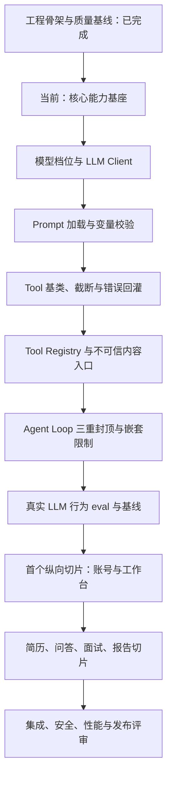

# 下一步执行计划

| 项目 | 内容 |
| --- | --- |
| 文档版本 | v0.6 |
| 文档状态 | 执行中 |
| 更新日期 | 2026-10-17 |
| 当前阶段 | 核心能力基座 |
| 当前目标 | 建立统一、可追踪、有硬上限的 LLM、Prompt、Tool 和 Agent Loop 基座 |
| 后续目标 | 完成核心基座后启动“账号 -> 工作台 -> 空状态”首个纵向切片 |
| 审批依据 | `docs/decision-register.md` v0.6 |

> `DR-01` 至 `DR-06` 已全部批准，ADR-0001 至 ADR-0008 已全部接受。工程骨架与质量基线已通过，当前不再有审批、架构或工程门禁阻塞；下一步是实现所有业务切片共用的核心能力基座。

## 1. 当前完成度

| 事项 | 状态 | 证据 | 是否阻塞下一步 |
| --- | --- | --- | --- |
| 全流程与阶段门禁 | 已完成 | `docs/development-flow.md` v1.8 | 否 |
| 需求基线 | 已完成 | `docs/requirements.md` v1.5 | 否 |
| 产品方案 | 已完成 | `docs/product-design.md` v1.5 | 否 |
| 需求决策 `DR-01` 至 `DR-06` | `approved` | `docs/decision-register.md` v0.6 | 否 |
| 技术设计 | 已完成 | `docs/technical-design.md` v0.7 | 否 |
| 数据模型与状态机 | 已完成 | `docs/data-model.md` v0.5、`docs/state-machine.md` v0.5 | 否 |
| 接口与安全基线 | 已完成 | `docs/api-contract.md` v0.6、`docs/threat-model.md` v0.4 | 否 |
| ADR-0001 至 ADR-0008 | 全部 `accepted` | `docs/adr/` | 否 |
| Python 工程 | 已完成 | `pyproject.toml`、`uv.lock`、`.python-version` | 否 |
| 应用与数据库骨架 | 已完成 | FastAPI、SQLAlchemy async、Alembic、初始迁移和 Compose | 否 |
| 可观测性与安全入口 | 已完成 | 请求 ID、结构化日志、脱敏、trace 契约和统一错误信封 | 否 |
| 测试、评测与质量门禁 | 已完成 | `22 passed, 10 skipped`；集成测试 `32 passed`；eval `1/1` | 否 |
| LLM 档位与 Client | 未开始 | 尚无 `app/llm/` 和真实调用入口 | 是 |
| Prompt 与 Tool Registry | 未开始 | 尚无 Markdown Prompt 加载、Schema 工具和统一注册表 | 是 |
| Agent Loop 与行为评测 | 未开始 | 尚无三重封顶主循环和真实 LLM eval | 是 |

当前没有外部审批阻塞或工程质量阻塞；剩余工作集中在核心能力基座。

## 2. 执行顺序

原则：

- 先建立可运行底座，再实现业务页面和 Agent 行为。
- 数据库迁移必须覆盖已接受 ADR 的数据约束，不用临时内存状态替代。
- 每个骨架项同时交付测试或可重复验证命令，不以“文件已创建”为完成。
- 核心基座完成前，不并行堆叠多个业务切片。

## 3. 工程骨架交付清单（已完成）

工程骨架已按下列范围落地，并通过迁移循环、静态检查、单元/集成测试和首次 eval 验证。本节保留为后续改动的影响检查清单。

### 3.1 Python 工程与配置

| 工作 | 交付物 | 完成判据 |
| --- | --- | --- |
| 初始化 `uv` 工程 | `pyproject.toml`、`uv.lock`、`.python-version` | 空环境执行 `uv sync` 可重复安装 |
| 固定运行依赖 | FastAPI、uvicorn、Pydantic Settings、SQLAlchemy、asyncpg、Redis、structlog、Argon2id | 依赖版本锁定且理由可追踪 |
| 固定开发依赖 | pytest、pytest-asyncio、respx、ruff、mypy、pre-commit | 本地命令可直接运行 |
| 配置入口 | `app/config.py`、`.env.example` | 缺失或非法配置启动时给出明确错误 |
| 环境样例 | 数据库、Redis、会话密钥、邮件和 LLM 配置 | `.env.example` 与配置模型字段一致 |

### 3.2 FastAPI 与服务基础

| 工作 | 交付物 | 完成判据 |
| --- | --- | --- |
| 应用工厂与入口 | `app/main.py` | uvicorn 可启动，装配逻辑不进入业务模块 |
| 健康检查 | `/health/live`、`/health/ready` | live 不依赖外部服务；ready 检查 PostgreSQL 和 Redis |
| 统一错误结构 | 错误模型和异常处理器 | 业务错误、校验错误和未知错误结构稳定 |
| 请求关联 | 请求 ID 中间件 | 响应、日志和后续任务可关联同一请求 |
| 生命周期 | 数据库、Redis 客户端启停 | 启动失败可定位，关闭时不泄漏连接 |

### 3.3 数据与异步任务

| 工作 | 交付物 | 完成判据 |
| --- | --- | --- |
| SQLAlchemy async 基座 | engine、session、事务边界 | 连接池配置明确，测试可注入会话 |
| Alembic | `alembic.ini`、env 和初始迁移 | 空库可升级到 `head` |
| 核心表首版 | 账号、会话、简历、问答、面试、轮次、报告、错题和审计表 | 约束、索引和保留字段与技术基线一致 |
| SSE 持久事件 | `qa_requests.last_event_seq`、`qa_stream_events` | `UNIQUE (qa_request_id, seq)` 和重连查询可验证 |
| 任务租约 | `async_jobs.lease_owner`、`fencing_token`、`lease_until` | `FOR UPDATE SKIP LOCKED` 领取和条件写入有测试 |
| 本地依赖 | PostgreSQL、Redis 编排或等价启动说明 | 新环境按文档可启动并完成迁移 |

### 3.4 可观测性与安全入口

| 工作 | 交付物 | 完成判据 |
| --- | --- | --- |
| 结构化日志 | structlog JSON 行输出 | 不使用 `print` 或裸 `logging` |
| 日志脱敏 | token、邮箱、手机号和身份证号过滤器 | 敏感样例不会原样进入日志 |
| LLM trace 骨架 | 模型、Prompt 版本、token、延迟、工具调用和请求 ID | 每次调用可通过统一入口记录 |
| 不可信内容入口 | `<untrusted>` 包裹工具 | 网页、上传文件和第三方响应统一处理 |
| 写操作保护 | `dry_run=True` 默认值 | 外部副作用工具无默认放行路径 |

### 3.5 测试、评测与质量门禁

| 工作 | 交付物 | 完成判据 |
| --- | --- | --- |
| pytest 基础 | `tests/`、fixture、事务回滚 | 测试默认不连接生产数据 |
| 外部依赖模拟 | respx 和数据库测试夹具 | HTTP 与数据库失败路径可稳定复现 |
| 评测入口 | `evals/run.py`、首批用例 | 可运行并保存首次基线 |
| 静态检查 | ruff、mypy、pre-commit | `ruff check`、`ruff format --check`、`mypy app` 通过 |
| CI 门禁 | 单测、lint、类型检查和迁移检查 | 合并前可重复执行，不依赖人工本机状态 |

## 4. 上一阶段退出条件（已满足）

“工程骨架与质量基线”完成需要同时满足：

- `uv sync` 在干净环境成功，锁文件与 `pyproject.toml` 一致。
- API 可启动，`/health/live` 与 `/health/ready` 返回符合契约的结果。
- 空 PostgreSQL 可从零迁移到最新版本，迁移方向和关键约束经过测试。
- PostgreSQL、Redis、SSE 事件和任务租约字段能在本地验证。
- 请求 ID、结构化日志和 LLM trace 骨架可关联一次请求或任务。
- `ruff check`、`ruff format --check`、`mypy app` 和 `pytest` 全部通过。
- 至少一条 eval 用例可运行并记录基线。
- `.env.example`、配置模型、迁移和启动文档保持一致。

验证证据：

- `ruff check .`、`ruff format --check .` 和 `mypy app tests evals migrations` 通过。
- 默认测试为 `22 passed, 10 skipped`；`RUN_INTEGRATION=1 uv run pytest -q` 为 `32 passed`。
- 空库迁移、降级、再次升级及 `alembic check` 通过。
- 首次 eval 为 `1/1 passed`，基线已写入 `evals/baseline.json`。
- 真实服务可启动，健康检查、请求 ID 和服务端时间响应头可验证。

## 5. 核心基座与首个切片

工程骨架完成后，先实现共享能力：

1. LLM Client：超时、重试、token 统计、trace 和脱敏。
2. Prompt 加载：Markdown、版本标识和变量校验。
3. Tool Registry：Pydantic schema、单一注册、截断和错误回灌。
4. Agent Loop：`max_steps`、`max_tokens`、`timeout` 三重封顶。
5. 异步 Worker：租约、fencing、退避、死信和优雅关闭。

随后交付“账号 -> 工作台 -> 空状态”，范围限定为：

- 注册、登录、退出、当前会话和邮件找回密码。
- 服务端可撤销会话、Cookie 属性和跨设备会话。
- 工作台摘要、空状态和历史分页入口。
- 所有权校验、未登录和越权错误。
- 单元、集成、安全、接口契约和 eval 门禁。

首个切片退出条件：

- 注册只返回中性受理结果，登录是唯一会话签发入口。
- 重置密码成功后旧会话全部失效。
- 未登录返回稳定认证错误，用户 A 无法读取用户 B 的资源。
- 质量命令、迁移和切片测试全部通过。
- 公开实现只依赖已批准需求或已接受 ADR。

## 6. 后续切片顺序

| 顺序 | 切片 | 进入条件 | 核心退出条件 |
| --- | --- | --- | --- |
| 1 | 账号与工作台 | 工程骨架、核心基座通过 | 认证、隔离、会话和删除边界可验证 |
| 2 | 简历闭环 | 异步 Worker 和对象存储已就绪 | 文件限制、分析失败、出题和删除通过 |
| 3 | 检索问答 | LLM、检索工具和 SSE 已就绪 | 证据、重连、降级和版本冻结通过 |
| 4 | 模拟面试 | 任务、评分和状态机已就绪 | 截止、幂等、恢复和解锁规则通过 |
| 5 | 报告与复习 | 面试终态数据稳定 | 追问树、错题、薄弱点和缺口报告通过 |
| 6 | 上线质量 | P0 切片全部完成 | 安全、性能、评测和发布门禁通过 |

## 7. 实现约束与风险

| 约束或风险 | 实现要求 | 阻断条件 |
| --- | --- | --- |
| ADR-0003 服务端截止 | 使用 PostgreSQL 时间，`server_now < deadline_at` 才有效 | 使用客户端时间或应用实例时间 |
| ADR-0006 SSE 重连 | 事件持久化，游标来自 PostgreSQL | 重连重复调用模型、扣预算或丢失终态 |
| ADR-0007 任务租约 | 领取递增 fencing token，写入校验 owner/token | 旧 Worker 可覆盖新租约 |
| ADR-0008 受保护反馈 | 终态且评分离开 `scoring` 后解锁 | 提交接口提前返回分数或评分无限卡住 |
| 骨架只建不使用 | 健康检查、迁移和 trace 先通过测试 | 业务模块直接绕过基座 |
| 依赖边界漂移 | 保持 `api -> agent -> tools -> llm` | 反向 import 或跨层直调 |
| 质量门禁后补 | 骨架阶段即建立 lint、类型和测试 | 先堆业务代码再补门禁 |

## 8. 完成定义

“下一步工作完成”需要同时满足：

- 工程骨架和核心基座在干净环境可启动、迁移、测试和评测。
- ADR-0003、ADR-0006、ADR-0007、ADR-0008 的实现约束有对应测试。
- `DR-01` 至 `DR-06` 在需求、接口、数据、状态和安全测试中一致。
- 首个纵向切片通过接口、权限、安全、质量和文档门禁。
- 开发全流程的当前阶段、阻塞和下一步与仓库实际状态一致。

## 9. 版本记录

| 版本 | 日期 | 变更 |
| --- | --- | --- |
| v0.1 | 2026-10-17 | 建立从决策审批、ADR 评审、工程骨架到首个纵向切片的执行计划 |
| v0.2 | 2026-10-17 | 记录 ADR-0001、ADR-0002、ADR-0004、ADR-0005 已接受，剩余四项技术评审 |
| v0.3 | 2026-10-17 | 记录 DR-01、DR-02 已批准并完成文档同步；剩余审批收敛为 DR-03 至 DR-06 |
| v0.4 | 2026-10-17 | 记录 DR-03 至 DR-06 已批准；需求审批全部关闭 |
| v0.5 | 2026-10-17 | 记录 ADR-0001 至 ADR-0008 全部接受；当前阶段切换为工程骨架与质量基线，补充 `uv`、FastAPI、迁移、SSE、任务租约、日志、测试和 eval 交付清单 |
| v0.6 | 2026-10-17 | 工程骨架与质量基线通过；记录静态检查、测试、迁移和 eval 证据，当前阶段切换为核心能力基座 |
