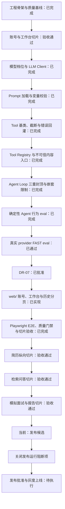

# 下一步执行计划

| 项目 | 内容 |
| --- | --- |
| 文档版本 | v3.0 |
| 文档状态 | 发布候选；工程门禁已通过，发布运行资产与恢复演练待补齐 |
| 更新日期 | 2026-10-18 |
| 当前阶段 | 发布候选（release candidate）；待发布批准与上线执行 |
| 当前目标 | 关闭[发布运行手册](./release-runbook.md)中的上线阻断项，再完成灰度上线 |
| 后续目标 | 灰度观测稳定后完成正式发布与复盘 |
| 审批依据 | `docs/decision-register.md` v0.8 |

> `DR-01` 至 `DR-07` 已批准，ADR-0001 至 ADR-0008 已接受。全部业务切片、隐私删除、保留清理和运维聚合指标已落地；隐私与可观测门禁已通过，G4A 行为矩阵已通过，真实 provider 三档单轮 eval、完整面试成本 P95 和生产依赖均通过。当前处于发布候选阶段；生产 Worker、部署资产、密码重置投递、备份恢复和回滚演练仍须按[发布运行手册](./release-runbook.md)关闭。

## 1. 当前完成度

| 事项 | 状态 | 证据 | 是否阻塞下一步 |
| --- | --- | --- | --- |
| 全流程与阶段门禁 | 已完成 | `docs/development-flow.md` v3.0 | 否 |
| 需求基线 | 已完成 | `docs/requirements.md` v1.5 | 否 |
| 产品方案 | 已完成 | `docs/product-design.md` v1.5 | 否 |
| 需求决策 `DR-01` 至 `DR-07` | `approved` | `docs/decision-register.md` v0.8 | 否 |
| 技术设计 | 已完成 | `docs/technical-design.md` v0.15 | 否 |
| 数据模型与状态机 | 已完成 | `docs/data-model.md` v0.7、`docs/state-machine.md` v0.5 | 否 |
| 接口与安全基线 | 已完成 | `docs/api-contract.md` v0.8、`docs/threat-model.md` v0.6 | 否 |
| ADR-0001 至 ADR-0008 | 全部 `accepted` | `docs/adr/` | 否 |
| Python 工程 | 已完成 | `pyproject.toml`、`uv.lock`、`.python-version` | 否 |
| 应用与数据库骨架 | 已完成 | FastAPI、SQLAlchemy async、Alembic、初始迁移和 Compose | 否 |
| 可观测性与安全入口 | 已完成 | 请求 ID、结构化日志、脱敏、trace 契约和统一错误信封 | 否 |
| LLM 档位与 Client | 已完成 | `app/llm/`；OpenAI/Anthropic 适配、重试、Schema 校验、trace 和费用统计测试通过 | 否 |
| Prompt 与 Tool Registry | 已完成 | Markdown 版本加载、变量校验、Pydantic Schema、注册契约、截断与错误回灌测试通过 | 否 |
| Agent Loop 与确定性行为评测 | 已完成 | 三重封顶、嵌套限制、终止、不可信内容、截断和工具选择用例通过；完整工具参数 Schema 已进入 Prompt | 否 |
| 阶段与审批文档契约 | 已完成 | `tests/test_decision_docs.py` 锁定 `DR-07`、首切片边界和发布候选阶段证据 | 否 |
| 集成、迁移与确定性评测 | 已完成 | `RUN_INTEGRATION=1 pytest` 为 `158 passed`（含矩阵、整场成本、DirectMail 与 OSS 适配器测试）；`alembic check` 无漂移；迁移头 `9f4c2a7d1e30`；确定性 eval `7/7` | 否 |
| 真实 provider 三档单轮 eval | `passed` | FAST `deepseek-flash`；DEFAULT/REASONING `deepseek-v4-pro`；均 2 steps、正确调用并返回 `42`；Prompt `agent_system@1.0.0+agent_turn@1.1.0` | 否 |
| 评分 Prompt 校准 | `passed` | `interview_scoring@1.1.0` 增加分数锚点、关键错误边界和受保护材料禁复述；同时修正矩阵锚点、跨题套话、部分答案覆盖度和矛盾题构念 | 否 |
| 110 条真实模型行为矩阵 | `passed` | 完整运行 `108/110`（98.18%），backend/frontend/fullstack 均 `30/30`；两条契约修正后定向复验 `2/2`，合计 `110/110`；`release_ready=true` | 否 |
| 完整面试成本 P95 | `passed` | 10 场真实完整面试均覆盖追问链；模型 P95 为 ¥0.83908，低于 ¥3.00；检索为数据库内词法排序，外部检索费用 ¥0，总计 P95 ¥0.83908；`release_ready=true` | 否 |
| 首个用户可见切片 `DR-07` | `approved` | `docs/decision-register.md` v0.8；方案 A | 否 |
| 前端工程与账号路径 | 已完成 | `web/`；注册、登录、找回/重置密码、空工作台和响应式导航 | 否 |
| 历史分页 | 已完成 | `web/src/pages/HistoryPage.tsx`；`{items, next_cursor}`，每页 10 条 | 否 |
| 浏览器 E2E | `passed` | Chromium 桌面与移动 `14 passed`，隐私专项 `2 passed`；GitHub Actions Ubuntu 24.04 托管 runner WebKit Desktop Safari + iPhone 13 `14 passed`（2.4 min）；本地 Ubuntu WebKit 同套件 `14 passed` | 否 |
| DirectMail 实际投递 | `passed` | `smtpdm.aliyun.com:465` + SSL 的 TLS 握手与登录通过；测试邮件于 2026-10-18T08:37:24Z 发往 `no-reply@rainstone.top`，SMTP 服务器接受且 `refused={}`；收件箱到达仍需人工确认 | 否 |
| OSS 简历上传与删除 | `passed` | 真实私有桶 PUT/GET/DELETE 通过；业务层 `upload_resume` 生成 `stored` 记录，读取内容与 PDF 字节一致；`delete_resume_source` 后状态为 `deleted` 且对象不可读 | 否 |
| 简历纵向切片 | `passed` | 上传、PDF/DOCX 校验、异步处理、10 道题、失败重试、原始文件删除和 `source_deleted` 状态通过 | 否 |
| 检索问答切片 | `passed` | owner 鉴权、幂等、任意 URL 拒绝、allowlist/版本冻结、证据引用校验、持久 SSE 重放、终态互斥和前端历史重开通过 | 否 |
| 模拟面试与报告切片 | `passed` | 数据库硬截止、操作幂等、202 中性响应、评分阈值、两层追问、跳过/结束分支、评分失败收口、报告解锁、错题与薄弱点、双视口 E2E 通过 | 否 |
| 隐私与可观测门禁 | `passed` | 账号删除、对象清理、保留清理、审计保留、删除状态、ops metrics、确定性阈值和双视口隐私 E2E 通过 | 否 |
| 全量质量门禁 | `passed` | 前端 typecheck、Vitest `12 files / 37 tests`、lint、build；后端 ruff、格式、mypy（103 files）、`121 passed, 49 skipped` 默认测试和 `alembic check` | 否 |
| 生产配置 fail-fast | `passed` | `staging`/`production` 启动校验 LLM、SMTP、OSS、HTTPS 重置链接、Secure Cookie 和非 localhost 来源 | 否 |
| 发布运行资产 | `blocked` | [发布与回滚运行手册](./release-runbook.md) v0.1；生产 Worker、镜像编排、密码重置异步投递、备份恢复和回滚演练未补齐 | 是 |

隐私与可观测门禁、G4A 行为矩阵、完整面试成本 P95、生产 DirectMail/OSS 和 GitHub Actions WebKit 均已关闭。当前处于发布候选阶段，发布运行资产仍阻断灰度上线。

## 2. 执行顺序

原则：

- 先建立可运行底座，再实现业务页面和 Agent 行为。
- 数据库迁移必须覆盖已接受 ADR 的数据约束，不用临时内存状态替代。
- 每个骨架项同时交付测试或可重复验证命令，不以“文件已创建”为完成。
- 核心基座完成前，不并行堆叠多个业务切片。

## 3. 工程骨架交付清单（已完成）

工程骨架已按下列范围落地，并通过迁移循环、静态检查、单元/集成测试和首次 eval 验证。本节保留为后续改动的影响检查清单。

### 3.1 Python 工程与配置

| 工作 | 交付物 | 完成判据 |
| --- | --- | --- |
| 初始化 `uv` 工程 | `pyproject.toml`、`uv.lock`、`.python-version` | 空环境执行 `uv sync` 可重复安装 |
| 固定运行依赖 | FastAPI、uvicorn、Pydantic Settings、SQLAlchemy、asyncpg、Redis、structlog、Argon2id | 依赖版本锁定且理由可追踪 |
| 固定开发依赖 | pytest、pytest-asyncio、respx、ruff、mypy、pre-commit | 本地命令可直接运行 |
| 配置入口 | `app/config.py`、`.env.example` | 缺失或非法配置启动时给出明确错误 |
| 环境样例 | 数据库、Redis、会话密钥、邮件和 LLM 配置 | `.env.example` 与配置模型字段一致 |

### 3.2 FastAPI 与服务基础

| 工作 | 交付物 | 完成判据 |
| --- | --- | --- |
| 应用工厂与入口 | `app/main.py` | uvicorn 可启动，装配逻辑不进入业务模块 |
| 健康检查 | `/health/live`、`/health/ready` | live 不依赖外部服务；ready 检查 PostgreSQL 和 Redis |
| 统一错误结构 | 错误模型和异常处理器 | 业务错误、校验错误和未知错误结构稳定 |
| 请求关联 | 请求 ID 中间件 | 响应、日志和后续任务可关联同一请求 |
| 生命周期 | 数据库、Redis 客户端启停 | 启动失败可定位，关闭时不泄漏连接 |

### 3.3 数据与异步任务

| 工作 | 交付物 | 完成判据 |
| --- | --- | --- |
| SQLAlchemy async 基座 | engine、session、事务边界 | 连接池配置明确，测试可注入会话 |
| Alembic | `alembic.ini`、env 和初始迁移 | 空库可升级到 `head` |
| 核心表首版 | 账号、会话、简历、问答、面试、轮次、报告、错题和审计表 | 约束、索引和保留字段与技术基线一致 |
| SSE 持久事件 | `qa_requests.last_event_seq`、`qa_stream_events` | `UNIQUE (qa_request_id, seq)` 和重连查询可验证 |
| 任务租约 | `async_jobs.lease_owner`、`fencing_token`、`lease_until` | `FOR UPDATE SKIP LOCKED` 领取和条件写入有测试 |
| 本地依赖 | PostgreSQL、Redis 编排或等价启动说明 | 新环境按文档可启动并完成迁移 |

### 3.4 可观测性与安全入口

| 工作 | 交付物 | 完成判据 |
| --- | --- | --- |
| 结构化日志 | structlog JSON 行输出 | 不使用 `print` 或裸 `logging` |
| 日志脱敏 | token、邮箱、手机号和身份证号过滤器 | 敏感样例不会原样进入日志 |
| LLM trace 骨架 | 模型、Prompt 版本、token、延迟、工具调用和请求 ID | 每次调用可通过统一入口记录 |
| 不可信内容入口 | `<untrusted>` 包裹工具 | 网页、上传文件和第三方响应统一处理 |
| 写操作保护 | `dry_run=True` 默认值 | 外部副作用工具无默认放行路径 |

### 3.5 测试、评测与质量门禁

| 工作 | 交付物 | 完成判据 |
| --- | --- | --- |
| pytest 基础 | `tests/`、fixture、事务回滚 | 测试默认不连接生产数据 |
| 外部依赖模拟 | respx 和数据库测试夹具 | HTTP 与数据库失败路径可稳定复现 |
| 评测入口 | `evals/run.py`、首批用例 | 可运行并保存首次基线 |
| 静态检查 | ruff、mypy、pre-commit | `ruff check`、`ruff format --check`、`mypy app` 通过 |
| CI 门禁 | 单测、lint、类型检查和迁移检查 | 合并前可重复执行，不依赖人工本机状态 |

## 4. 上一阶段退出条件（已满足）

“工程骨架与质量基线”完成需要同时满足：

- `uv sync` 在干净环境成功，锁文件与 `pyproject.toml` 一致。
- API 可启动，`/health/live` 与 `/health/ready` 返回符合契约的结果。
- 空 PostgreSQL 可从零迁移到最新版本，迁移方向和关键约束经过测试。
- PostgreSQL、Redis、SSE 事件和任务租约字段能在本地验证。
- 请求 ID、结构化日志和 LLM trace 骨架可关联一次请求或任务。
- `ruff check`、`ruff format --check`、`mypy app` 和 `pytest` 全部通过。
- 至少一条 eval 用例可运行并记录基线。
- `.env.example`、配置模型、迁移和启动文档保持一致。

验证证据：

- `ruff check .`、`ruff format --check .` 和 `mypy app tests evals migrations` 通过。
- 默认测试可运行；`RUN_INTEGRATION=1 uv run pytest -q` 当前为 `158 passed`。
- 空库迁移、降级、再次升级及 `alembic check` 通过。
- 首次 eval 已通过并写入 `evals/baseline.json`；当前确定性 eval 为 `3/3`。
- 真实服务可启动，健康检查、请求 ID 和服务端时间响应头可验证。

## 5. 核心基座与已验收切片

核心基座共享能力已经落地：

1. LLM Client：超时、有限重试、token 统计、trace、费用记录和日志脱敏。
2. Prompt 加载：Markdown、版本标识、变更说明和变量校验。
3. Tool Registry：Pydantic schema、单一注册、截断和结构化错误回灌；完整参数 Schema 已进入每轮 Prompt。
4. Agent Loop：`max_steps`、`max_tokens`、`timeout` 三重封顶及嵌套限制。
5. 安全基线：`<untrusted>` 包裹、写入工具 `dry_run=True` 和私有大结果文件权限。

核心基座关闭前还需（已提供入口）：

1. 配置真实 `LLM_API_KEY`、供应商和至少一组可用模型名。
2. 运行 `uv run python -m evals.provider_behavior --tier FAST`，记录工具选择、结构化输出、终止、延迟、token 和费用；本轮已完成。
3. 将真实评测结果与确定性基线分开记录，不以 mock 结果代替模型验收。
4. 评估三档真实调用成本与超时；三档单轮已通过，异常边界、110 条矩阵和成本 P95 再形成完整 G4A 结论。

异步 Worker 已随简历切片落地，提供任务租约、fencing、重试和简历状态链；阿里云 OSS 生产适配器已实现，待真实桶与凭据验收。

随后交付“账号 -> 工作台 -> 空状态”，现已实现：

- 注册、登录、退出、当前会话和邮件找回密码。
- 服务端可撤销会话、Cookie 属性和跨设备会话。
- 工作台摘要、空状态和历史分页入口。
- 所有权校验、未登录和越权错误。
- 单元、集成、安全、接口契约和 eval 门禁。
- 同一切片建立 `web/`、页面路由与 API 集成；登录使用 `interview_session`（`HttpOnly`），CSRF 使用可读 `interview_csrf` 与 `X-CSRF-Token`，数据库 `auth_sessions.csrf_token_hash` 只保存 verifier 哈希。
- 历史接口统一返回 `{items, next_cursor}`；前端每次请求 10 条并支持继续加载。

账号切片退出条件（已全部满足）：

- 注册只返回中性受理结果，登录是唯一会话签发入口。
- 重置密码成功后旧会话全部失效。
- 未登录返回稳定认证错误，用户 A 无法读取用户 B 的资源。
- 质量命令、迁移和切片测试全部通过。
- 公开实现只依赖已批准需求或已接受 ADR。

模拟面试与报告切片已交付：

- `/interviews`、`/interviews/:id`、`/reviews` 与创建、开始、答题、跳过、结束分支、报告和复习接口均按 owner 隔离。
- 开始操作使用 PostgreSQL 时间写入 40 分钟截止时间；创建、开始、跳过和结束分支均支持幂等重放。
- 回答提交固定返回 `202` 和中性进度，不返回分数、通过结论、参考答案或追问依据。
- 评分权重固定为 35/25/20/10/10，阈值、关键错误和追问触发由确定性代码判定。
- 每条追问链最多 2 层、3 次回答；跳过与结束分支分别保存稳定原因。
- 永久评分失败转为 `scoring_failed`，报告标记 `incomplete_scoring`；终态且所有已接收轮次离开 `scoring` 后解锁受保护反馈。
- 报告展示追问树、错题、薄弱点和复习建议；未作答、跳过和评分失败轮次不写入错题。

## 6. 简历切片验收与后续顺序

简历切片退出条件（已全部满足）：

- PDF/DOCX、10 MB、10 页、空文本和不支持格式均有确定性结果。
- 结构化分析、未验证信息、10 题覆盖计划和隐藏评分材料通过 Schema 与业务测试。
- 异步处理、失败重试、原始文件删除和 `source_deleted` 证据摘要通过接口、Worker 与 E2E。
- 前端在桌面和移动视口完成上传、处理中、结果和删除闭环。

后续切片顺序：

| 顺序 | 切片 | 进入条件 | 核心退出条件 |
| --- | --- | --- | --- |
| 1 | 账号与工作台 | 当前切片 E2E 和质量门禁通过（已完成） | 认证、隔离、会话、历史分页和响应式导航可验证（已满足） |
| 2 | 简历闭环（已完成） | 异步 Worker 和对象存储已就绪 | 文件限制、分析失败、出题和删除通过 |
| 3 | 检索问答（已完成） | LLM、检索工具、知识源 allowlist 和持久 SSE 已就绪 | 证据、重连、降级和版本冻结通过 |
| 4 | 模拟面试（已完成） | 问答切片、任务、评分和状态机已就绪 | 截止、幂等、恢复和解锁规则通过 |
| 5 | 报告与复习（已完成） | 面试终态数据稳定 | 追问树、错题、薄弱点和缺口报告通过 |
| 6 | 发布候选与上线（已完成候选门禁） | P0 切片全部完成 | 技术质量、生产邮件、对象存储和 WebKit CI 均已通过；待发布批准与灰度执行 |

## 7. 实现约束与风险

| 约束或风险 | 实现要求 | 阻断条件 |
| --- | --- | --- |
| ADR-0003 服务端截止 | 使用 PostgreSQL 时间，`server_now < deadline_at` 才有效 | 使用客户端时间或应用实例时间 |
| ADR-0006 SSE 重连 | 事件持久化，游标来自 PostgreSQL | 重连重复调用模型、扣预算或丢失终态 |
| ADR-0007 任务租约 | 领取递增 fencing token，写入校验 owner/token | 旧 Worker 可覆盖新租约 |
| ADR-0008 受保护反馈 | 终态且评分离开 `scoring` 后解锁 | 提交接口提前返回分数或评分无限卡住 |
| 骨架只建不使用 | 健康检查、迁移和 trace 先通过测试 | 业务模块直接绕过基座 |
| 依赖边界漂移 | 保持 `api -> agent -> tools -> llm` | 反向 import 或跨层直调 |
| 生产对象存储已验收 | 阿里云 OSS 私有桶上传、读取、删除和清理链路通过；发布时复核 IAM、加密和版本/生命周期 | 使用公开链接、过宽权限或无租约清理 |
| 质量门禁后补 | 骨架阶段即建立 lint、类型和测试 | 先堆业务代码再补门禁 |

## 8. 完成定义

“下一步工作完成”需要同时满足：

- 工程骨架和核心基座在干净环境可启动、迁移、测试和评测。
- ADR-0003、ADR-0006、ADR-0007、ADR-0008 的实现约束有对应测试。
- `DR-01` 至 `DR-06` 在需求、接口、数据、状态和安全测试中一致。
- 账号、简历、检索问答、模拟面试与报告切片通过接口、权限、安全、质量和文档门禁。
- 开发全流程的当前阶段、阻塞和下一步与仓库实际状态一致。
- 110 条真实模型行为矩阵达到发布门槛（已满足）。
- 完整面试模型与检索成本 P95 不高于 ¥3.00，且样本覆盖追问链。

## 9. 版本记录

| 版本 | 日期 | 变更 |
| --- | --- | --- |
| v0.1 | 2026-10-17 | 建立从决策审批、ADR 评审、工程骨架到首个纵向切片的执行计划 |
| v0.2 | 2026-10-17 | 记录 ADR-0001、ADR-0002、ADR-0004、ADR-0005 已接受，剩余四项技术评审 |
| v0.3 | 2026-10-17 | 记录 DR-01、DR-02 已批准并完成文档同步；剩余审批收敛为 DR-03 至 DR-06 |
| v0.4 | 2026-10-17 | 记录 DR-03 至 DR-06 已批准；需求审批全部关闭 |
| v0.5 | 2026-10-17 | 记录 ADR-0001 至 ADR-0008 全部接受；当前阶段切换为工程骨架与质量基线，补充 `uv`、FastAPI、迁移、SSE、任务租约、日志、测试和 eval 交付清单 |
| v0.6 | 2026-10-17 | 工程骨架与质量基线通过；记录静态检查、测试、迁移和 eval 证据，当前阶段切换为核心能力基座 |
| v0.7 | 2026-10-17 | 记录 LLM/Prompt/Tool/Loop 与确定性行为评测完成；真实供应商模型评测待凭据，明确前端随首切片建立及首个切片审批门 |
| v0.8 | 2026-10-17 | 补齐工具参数 Schema 注入与预算估算缺口；同步基座验收证据，真实供应商模型评测和首切片审批仍是后续阻塞 |
| v0.9 | 2026-10-17 | 登记 `DR-07` 为首个用户可见切片审批项；同步待审批状态、前端工程阻塞和推荐实现边界 |
| v1.0 | 2026-10-17 | 增加阶段与审批文档契约测试；记录完整质量门禁 `67 passed, 10 skipped` |
| v1.1 | 2026-10-17 | 复跑并记录 `77 passed` 集成门禁、无漂移迁移检查和 `2/2` 确定性 eval；真实模型证据和 `DR-07` 审批仍是外部门禁 |
| v1.2 | 2026-10-17 | `DR-07` 方案 A 已批准；`web/`、账号与历史切片已实现；真实 provider FAST eval 已通过；当前进入 E2E、质量门禁和验收收尾，完整 G4A 模型矩阵仍未关闭 |
| v1.3 | 2026-10-17 | 首个用户可见纵向切片验收通过：双视口 E2E `2 passed`、前端质量门禁、后端 `88 passed`、迁移检查通过；下一阶段为简历闭环，完整 G4A 模型矩阵仍未关闭 |
| v1.4 | 2026-10-17 | 同步技术设计 v0.10 与开发流程 v2.6；更新文档契约证据，保留异步 Worker、对象存储、简历闭环和完整 G4A 矩阵为后续工作 |
| v1.5 | 2026-10-17 | 简历纵向切片验收通过：双视口 E2E `4 passed`、前端 `7 files / 21 tests`、后端 `107 passed`、mypy 78 files、确定性 eval `3 passed`、迁移头 `8f3d2a1c7b90`；下一阶段切换为检索问答 |
| v1.6 | 2026-10-18 | 检索问答切片验收通过：双视口 E2E `8 passed`、问答专项 `4 passed`、前端 `9 files / 32 tests`、后端 `116 passed`、mypy 84 files、确定性 eval `3/3`、迁移头 `4b6e9d2c1a70`；下一阶段切换为模拟面试与报告切片 |
| v1.7 | 2026-10-18 | 模拟面试与报告切片验收通过：双视口 E2E `12 passed`、面试专项 `4 passed`、前端 `11 files / 36 tests`、后端 `126 passed`、mypy 58 files、确定性 eval `3/3`、迁移头 `7d1a3e5b9c42`；下一阶段切换为上线质量切片 |
| v1.8 | 2026-10-18 | 上线质量切片进行中：隐私删除、保留清理、审计保留、ops metrics、确定性阈值 eval 与双视口隐私 E2E 已通过；双视口 E2E `14 passed`、前端 `12 files / 37 tests`、后端 `130 passed`、mypy 67 files、确定性 eval `7/7`、迁移头 `9f4c2a7d1e30`；完整 G4A 模型矩阵仍未关闭 |
| v1.9 | 2026-10-18 | 完成 110 条真实模型行为矩阵：`82/110`（74.55%），critical 86.21%，`release_ready=false`；记录 backend/frontend/fullstack 分别 73.33%/60.00%/80.00%；单次评分调用成本 P95 为 ¥0.097853，但不作为完整面试成本 P95 证据 |
| v2.0 | 2026-10-18 | 修正矩阵构念失真与评分 Prompt 后，完整复跑 `108/110`（98.18%），backend/frontend/fullstack 均 `30/30`；两条共享契约修正后定向复验 `2/2`，合计 `110/110`，行为矩阵 `release_ready=true`。单次评分调用成本 P95 ¥0.099954，完整面试成本 P95 仍未测量 |
| v2.1 | 2026-10-18 | 完成真实整场面试成本基准：10 场完整 Worker 链路全部覆盖追问，模型调用 74 次，模型成本 P95 ¥0.83908；检索为数据库内词法排序，外部检索费用 ¥0；总成本 P95 ¥0.83908，`release_ready=true`。当前进入发布评审 |
| v2.2 | 2026-10-18 | 发布评审启动：技术质量、隐私和 G4A 门禁通过；SMTP 生产投递失败不再静默吞错；真实邮件供应商、生产对象存储与 WebKit 兼容 CI 仍为发布前确认项 |
| v2.3 | 2026-10-18 | 发布依赖选定：邮件使用阿里云 DirectMail SMTP；原始简历使用阿里云 OSS 私有桶；WebKit 兼容由 GitHub Actions `ubuntu-latest` 的 Desktop Safari 与 iPhone 13 Playwright 项目覆盖 |
| v2.4 | 2026-10-18 | DirectMail 账号验证通过：项目 `.env` 使用 `smtpdm.aliyun.com:465` + SSL，TLS 握手与 SMTP 登录成功；587/StartTLS 在本机网络超时。尚未发送测试邮件 |
| v2.5 | 2026-10-18 | DirectMail 实际发送测试通过：测试邮件发往 `no-reply@rainstone.top`，SMTP 服务器接受且无拒收收件人；至此 DirectMail 连接、认证和发送均已验证 |
| v2.6 | 2026-10-18 | 阿里云 OSS 真实私有桶验收通过：临时对象 PUT/GET/DELETE 成功；简历业务上传后对象状态 `stored` 且内容一致；删除源文件后状态 `deleted` 且对象不可读 |
| v2.7 | 2026-10-18 | Ubuntu 24.04 Playwright WebKit 本地容器实跑 `14 passed`（4.1 min），覆盖 Desktop Safari + iPhone 13；新增 `workflow_dispatch` 与失败 Playwright 报告上传，GitHub Actions 托管 runner 实跑待推送 |
| v2.8 | 2026-10-18 | GitHub Actions `ubuntu-latest` 托管 runner WebKit 实跑通过：Desktop Safari + iPhone 13 `14 passed`（2.4 min）；修复 preview 构建的 API 地址注入，增加手动 grep、默认零重试和全局超时；quality job 全绿 |
| v2.9 | 2026-10-18 | 阶段切换至发布候选：全部业务切片、技术质量、生产 DirectMail/OSS 和 WebKit 门禁通过；下一步为发布批准、回滚/备份检查、灰度上线与观测 |
| v3.0 | 2026-10-18 | 增加生产配置 fail-fast 与发布运行手册；记录生产 Worker、部署资产、密码重置异步投递、备份恢复和回滚演练为上线阻断项；默认质量门禁更新为 `121 passed, 49 skipped`、mypy 103 files |
