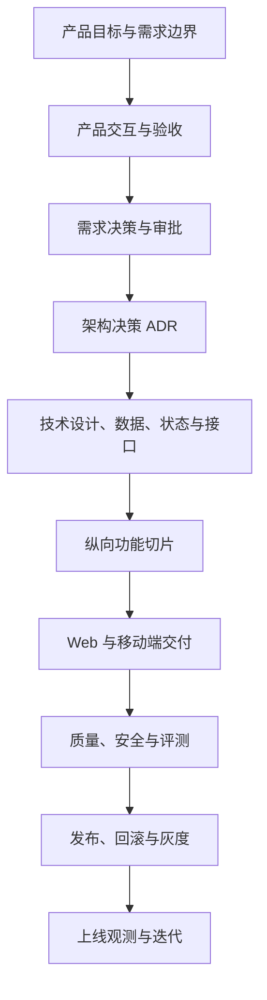

# 方案总览

| 项目 | 内容 |
| --- | --- |
| 文档版本 | v1.1 |
| 文档状态 | 当前方案导航 |
| 更新日期 | 2026-10-23 |
| 适用范围 | 产品、技术、交付与发布方案的统一入口 |
| 当前阶段 | 发布候选；生产复核、发布批准与上线执行待完成 |

> 本文件回答“有哪些方案、各自解决什么问题、现在做到哪里、下一步看哪份文档”。
> 方案规格与实施计划的统一目录是[Superpowers 方案目录](./superpowers/README.md)。
> 需求规则以[需求文档](./requirements.md)和[决策登记](./decision-register.md)为准；
> 技术约束以[ADR 索引](./adr/README.md)和[技术设计](./technical-design.md)为准；
> 发布状态以[发布与回滚运行手册](./release-runbook.md)为准。本文件不替代这些基线。

## 1. 方案全景

## 2. 方案分层

| 层 | 核心问题 | 权威文档 | 当前结论 |
| --- | --- | --- | --- |
| 产品与需求 | 为谁解决什么问题，P0 边界与验收是什么 | [需求](./requirements.md)、[产品方案](./product-design.md) | P0 业务切片已实现；产品规则冻结于需求 v1.6 |
| 需求决策 | 哪些用户可见行为必须审批，结论是什么 | [决策登记](./decision-register.md) | `DR-01` 至 `DR-09` 已批准；`DR-07` 选择方案 A |
| 架构与技术 | 系统如何分层、存数、执行任务和保护数据 | [技术设计](./technical-design.md)、[ADR 索引](./adr/README.md) | ADR-0001 至 ADR-0010 已接受 |
| 数据、状态与接口 | 数据约束、状态迁移和外部契约是什么 | [数据模型](./data-model.md)、[状态机](./state-machine.md)、[接口契约](./api-contract.md) | P0、私有资料和共享资料契约已落地 |
| 纵向切片 | 每个用户闭环做到哪里 | [开发全流程](./development-flow.md)、[Superpowers 方案目录](./superpowers/README.md) | 账号、简历、问答、面试、报告和隐私闭环已验收 |
| 移动端交付 | iOS 与 Android 如何复用 Web 能力 | [Superpowers 方案目录](./superpowers/README.md#2-方案索引)、[iOS 发布](./ios-release.md)、[Android 发布](./android-release.md) | iOS 仅完成工程与预检；Android 采用 Capacitor 8 |
| 质量与安全 | 哪些风险会阻断发布 | [评审清单](./technical-review-checklist.md)、[威胁模型](./threat-model.md) | 质量、权限、隐私和模型评测门禁已通过 |
| 发布与运维 | 如何备份、迁移、灰度、告警和回滚 | [发布手册](./release-runbook.md)、[演练记录](#6-运行证据) | 本地演练已通过；生产复核和发布批准未关闭 |

## 3. 当前事实

### 3.1 已落地

- Web 端已实现注册登录、找回密码、工作台、历史、简历、问答、模拟面试、报告、复习、隐私删除和资料库。
- 后端已提供服务端权威截止、持久 SSE 重放、数据库任务租约、幂等、owner 隔离、审计和保留清理。
- 私有资料支持 PDF、DOCX、TXT、Markdown 上传，异步索引、pgvector 与词法 RRF 检索，以及 Ollama 不可用时的降级。
- 共享资料使用独立资源与管理员角色；普通用户可查看和检索，管理员可上传和删除，个人资料仍严格按 owner 隔离。
- Android 以 `web/android` 的 Capacitor 8 壳交付，测试验证 HTTPS-only、App Link、Cookie、文件选择和签名变量。
- iOS 以 `ios/` 的原生 `WKWebView` 壳交付工程结构和预检脚本；签名、TestFlight 与商店提交未完成。
- 最新迁移头为 `1b5d8e3f7a20`；发布候选证据基线迁移头为 `7e2b4c6d8f10`；启用集成测试的完整套件为 `346 passed`；确定性 eval 为 `7/7`；完整 G4A 矩阵为 `110/110`；整场成本 P95 为 ¥0.83908。

### 3.2 未关闭

| 事项 | 当前状态 | 证据与下一步 |
| --- | --- | --- |
| 生产环境复核 | 未关闭 | 按[发布手册第 2 节](./release-runbook.md#2-上线阻断项)完成配置、灾备、邮件、OSS 和通知渠道签字 |
| 发布批准与灰度 | 未关闭 | 指定灰度范围、观察窗口、回滚负责人和 No-Go 阈值 |
| iOS 签名与商店提交 | 未开始 | 完整 Xcode、签名身份、Profile、TestFlight 和 App Store Connect 素材待补齐 |
| Android 商店提交 | 人工步骤 | Play Console 的 AAB、数据安全表、内容分级、应用签名和商店素材由账号持有人完成 |

### 3.3 历史文档的正确读法

- “规格”回答准备做什么；“计划”回答准备怎样实现；“ADR”回答为什么采用当前技术约束。
- 合并后的代码和测试是“是否落地”的证据；历史规格中的“待审查”和计划里的未勾选步骤不自动表示当前待办。
- 同一个事实出现冲突时，按本文件第 4 节选择权威来源，并更新导航或基线，不在历史记录中倒改证据。

## 4. 文档权威顺序

1. **当前需求与用户可见行为**：[需求文档](./requirements.md)、[决策登记](./decision-register.md)。
2. **当前架构约束**：[ADR 索引](./adr/README.md)、[技术设计](./technical-design.md)、[威胁模型](./threat-model.md)。
3. **当前数据与接口**：[数据模型](./data-model.md)、[状态机](./state-machine.md)、[接口契约](./api-contract.md)。
4. **当前交付与发布状态**：[开发全流程](./development-flow.md)、[发布与回滚运行手册](./release-runbook.md)。
5. **方案来龙去脉**：[Superpowers 方案目录](./superpowers/README.md#2-方案索引)、[规格与计划](#5-规格与实施计划)和演练记录。

冲突处理规则：

- 产品语义冲突：先回看决策登记，必要时新开 `DR`，未经批准不得用实现反向冻结需求。
- 技术选择冲突：先回看 ADR；现有 ADR 不适用时新增 ADR，并标明替代关系。
- 状态冲突：以代码、测试、迁移和发布证据为准，再统一更新总览与导航，不修改历史演练结论。
- 版本冲突：正文表格中的版本优先于叙述性文字；README 只引用版本，不另建版本号。

## 4.1 ADR 索引

| 决策 | 主题 |
| --- | --- |
| [ADR-0001](./adr/0001-layering.md) | 固定分层与依赖方向 |
| [ADR-0002](./adr/0002-database-as-source-of-truth.md) | PostgreSQL 作为业务事实与幂等来源 |
| [ADR-0003](./adr/0003-server-authoritative-deadline.md) | 面试截止由服务端权威控制 |
| [ADR-0004](./adr/0004-llm-client-and-trace.md) | 统一 LLM Client 与调用 Trace |
| [ADR-0005](./adr/0005-tool-registry-and-untrusted-content.md) | Tool Registry 与不可信内容边界 |
| [ADR-0006](./adr/0006-sse-contract.md) | 问答使用可重连 SSE 事件流 |
| [ADR-0007](./adr/0007-database-job-queue.md) | P0 使用 PostgreSQL 任务表作为异步队列 |
| [ADR-0008](./adr/0008-protected-feedback.md) | 受保护反馈按整场终态解锁 |
| [ADR-0009](./adr/0009-hybrid-rag-for-private-documents.md) | 私有资料采用 pgvector、BM25 和 RRF |
| [ADR-0010](./adr/0010-shared-documents-and-admin-role.md) | 共享资料采用独立资源与管理员角色 |

## 5. 规格与实施计划

所有方案规格和计划统一由[Superpowers 方案目录](./superpowers/README.md)维护。这里仅保留跨方案摘要：

| 方案 | 规格 | 计划 | 状态 |
| --- | --- | --- | --- |
| 私有内部资料混合 RAG | [设计规格](./superpowers/specs/user-rag-design.md) | [实施计划](./superpowers/plans/user-rag.md) | 已实现 |
| 共享资料与管理员权限 | [设计规格](./superpowers/specs/shared-documents-design.md) | [实施计划](./superpowers/plans/shared-documents.md) | 已实现并合并 |
| Android 发布接入 | [设计规格](./superpowers/specs/android-release-design.md) | [实施计划](./superpowers/plans/android-release.md) | 已实现，含设计修订 |
| iOS 发布接入 | [设计规格](./superpowers/specs/ios-release-design.md) | [实施计划](./superpowers/plans/ios-release.md) | 工程与预检完成，签名与商店提交待完成 |

## 6. 运行证据

| 证据 | 记录 | 结论 |
| --- | --- | --- |
| 数据库恢复 | [2026-10-18 恢复演练](./database-restore-drill.md) | 本地隔离实例通过；生产灾备待复核 |
| 应用回滚 | [2026-10-18 回滚演练](./application-rollback-drill.md) | 本地隔离编排通过；生产镜像与网络待复核 |
| 告警送达 | [2026-10-19 告警演练](./alert-delivery-drill.md) | 本地真实 webhook 5/5；生产通知渠道待复核 |

## 7. 后续顺序

1. 冻结发布 SHA 与生产配置，确认密钥、HTTPS 来源、Cookie 和 Worker 参数。
2. 复核生产灾备、镜像、网络、DirectMail DNS 与投递、OSS 权限与生命周期、通知渠道。
3. 完成 iOS 签名与 TestFlight 验证；Android 仍在人工商店提交前保持发布候选状态。
4. 取到发布批准后执行灰度，观察错误率、任务成功率、首段延迟、评分失败率、检索命中率、成本和删除任务。
5. 灰度稳定后正式发布并复盘；后续需求重新进入决策登记，不直接改写已冻结基线。

## 8. 维护规则

- 新增 ADR、规格或计划时，在同一变更中更新[Superpowers 方案目录](./superpowers/README.md)和本文件第 5 节。
- 新增 `DR` 时，同步更新本文件、决策登记和受影响的需求、产品、接口文档。
- 发布阻断项变化时，只更新[发布手册](./release-runbook.md)与本文件第 3.2 节，不在历史演练记录中倒改结论。
- 设计实现方式改变时，新增 ADR 或在规格中增加明确的修订记录；不得让规格与代码长期分叉。
- 本文件的“已实现”必须有代码、测试或合并记录支撑；“未关闭”必须链接到可执行证据或负责人事项。

## 9. 版本记录

| 版本 | 日期 | 变更 |
| --- | --- | --- |
| v1.0 | 2026-10-23 | 建立方案总览；统一产品、决策、架构、切片、移动端、发布与历史文档的入口、状态和权威顺序 |
| v1.1 | 2026-10-23 | 将全部方案规格与实施计划统一归入 `docs/superpowers/`，补齐 iOS 规格与计划入口 |
