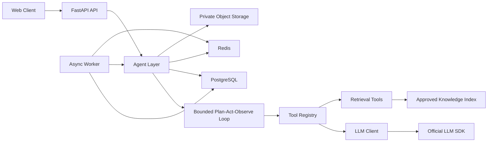

# 技术面试智能体技术设计

| 项目 | 内容 |
| --- | --- |
| 文档版本 | v0.14 |
| 文档状态 | 发布评审待确认；隐私与可观测门禁、G4A 行为矩阵与整场成本门禁已通过，生产依赖已选定 |
| 更新日期 | 2026-10-18 |
| 需求依据 | `docs/requirements.md` v1.5 |
| 产品依据 | `docs/product-design.md` v1.5 |
| 决策依据 | `docs/decision-register.md` v0.8 |

> 本设计只落实已确认需求。`DR-01` 至 `DR-07` 已批准；`DR-07` 按方案 A 冻结首个用户可见切片和前端工程边界。ADR-0001 至 ADR-0008 已于 2026-10-17 完成技术评审并接受，技术方案门禁已关闭。

## 1. 设计目标

- 将需求、产品规则和技术实现通过稳定标识连接。
- 用确定性代码控制权限、预算、状态迁移、评分阈值和受保护内容解锁。
- 保证每次模型调用可追踪、可重试、可估成本，并受步数、token、时长和嵌套深度限制。
- 支持异步简历处理、流式问答、面试中断恢复和服务端硬截止。
- 不引入 LangChain、LlamaIndex、CrewAI 等上层智能体框架。

## 2. 总体架构



依赖方向遵循 `AGENTS.md` 的项目红线：

```text
api -> agent -> tools -> llm
```

`tools/` 不导入 `api/` 或 `agent/`，`llm/` 不感知业务资源。用例编排放在 `agent/` 层内部；仓储、对象存储和邮件等基础设施通过明确接口注入，不使用全局可变状态。

依赖矩阵：

| 来源 | 允许依赖 | 禁止依赖 |
| --- | --- | --- |
| `app/api/` | `app/agent/`、配置与 DTO | `app/llm/`、`app/tools/`、数据库直接写入 |
| `app/agent/` | `app/tools/`、基础设施接口、`llm` 公共类型 | `app/api/`、具体路由 |
| `app/tools/` | `app/llm/`、标准库和工具依赖 | `app/api/`、`app/agent/` |
| `app/llm/` | 厂商 SDK、配置、日志与 trace 基础能力 | 业务模块、权限和资源所有权判断 |

`app/worker/` 是进程装配入口，只能通过 `agent` 暴露的用例接口执行任务，不复制业务状态规则。基础设施适配器可以放在所属模块内部或独立基础设施包中，但只能通过接口被 `agent` 使用。

## 3. 模块职责

| 模块 | 职责 | 禁止事项 |
| --- | --- | --- |
| `app/api/` | 路由、认证依赖、Pydantic 请求响应、HTTP 错误映射 | 业务状态迁移、Prompt 拼装、直接访问模型 |
| `app/agent/` | plan -> act -> observe、用例编排、事务边界、权限、幂等、状态快照和预算消费 | 无上限循环、直接执行写操作 |
| `app/tools/` | 单一能力的参数模型、描述和执行 | 路由逻辑、跨工具共享可变状态 |
| `app/llm/` | SDK 调用、重试、超时、trace、日志脱敏 | 业务权限判断、直接返回未校验模型结果 |
| `app/prompts/` | Markdown Prompt 和版本元数据 | 在 Python 中拼接提示词 |
| `app/worker/` | 异步任务领取、重试、超时和死信处理 | 使用无界轮询或阻塞休眠 |
| `app/config.py` | Pydantic Settings 唯一配置入口 | 代码内散写密钥、模型名或环境差异 |
| `web/` | React + TypeScript + Vite Web 客户端、路由、请求缓存和页面级测试 | 自行判断权限、在客户端保存会话令牌、绕过 API 契约 |

## 4. 核心运行链路

### 4.1 简历任务

```text
上传
  -> 校验扩展名、MIME、大小、页数
  -> 私有对象存储写入
  -> 创建 resume_task 和 async_job
  -> 返回 202

Worker
  -> 提取文本
  -> 结构化分析
  -> 生成 10 道题
  -> 校验 Schema、覆盖和去重
  -> 原子写入分析、题目和完成状态
```

上传请求只负责安全接收和创建任务。解析、分析和出题在 Worker 中执行。每个阶段写入独立阶段状态和错误码，失败任务保留原记录，重试创建新任务 ID。

### 4.2 检索问答

```text
创建 QA request
  -> 加载知识源白名单和版本
  -> 生成检索计划
  -> 查询批准知识源
  -> 相关性过滤、去重和预算裁剪
  -> 生成结构化回答
  -> 校验引用、证据和延伸问题
  -> 持久化增量事件与最终答案
  -> 持久化 completed 事件
  -> SSE 发送已持久化事件
```

任意 URL、用户上传文件或未授权知识源在检索计划阶段被拒绝。回答中的关键事实只能引用当前请求冻结的证据 ID。

实现状态：P0 问答切片已验收。`POST /api/v1/qa` 创建请求，`GET /api/v1/qa/{id}` 返回当前状态与结果，`GET /api/v1/qa/{id}/stream` 提供持久事件流；三个接口均按 owner 隔离。`Idempotency-Key` 与请求指纹冲突返回稳定错误；只检索 allowlist 中最新已发布版本。证据在任务执行时冻结，公开 DTO 仅返回 `citation_id`、标题、章节路径、最长 200 字符片段、相关度和 `source_state`，不暴露内部 UUID 或对象位置。事件按持久化序号通过 `after_seq` 或 `Last-Event-ID` 重放，`completed` 与 `error` 互斥。

### 4.3 模拟面试

```text
创建面试
  -> 选择方向配置版本
  -> 生成内部蓝图
  -> 创建根轮次和追问链
  -> in_progress + deadline_at

提交回答
  -> 校验所有者、轮次、幂等键和服务端截止时间
  -> 锁定轮次和追问链
  -> 一次性写入回答
  -> 返回 202、接收时间和中性进度（完成数、剩余题数、剩余时间）
  -> 异步结构化评分
  -> 确定性计算总分和通过结论
  -> 生成或终止追问
  -> 更新进度

结束当前追问链
  -> 记录 user_ended_branch
  -> 当前链进入 branch_completed
  -> 进入下一主问题，不设置整场 ended_at

整场结束或 P1 提前结束整场
  -> 所有已接收轮次评分完成
  -> 聚合报告、错题和薄弱点
  -> 设置 feedback_unlocked_at
  -> 返回受保护反馈
```

评分结果在整场结束前只通过内部服务读取，不进入用户响应。回答提交 DTO 不读取评分字段；公开响应固定为 `202 Accepted`、已接收状态和中性进度。进行中查询只能展示 `DR-03` 允许的中性流程信息，不得返回趋势、预测、关键错误或追问触发依据。P0 只有结束当前追问链操作；P1 才允许独立、二次确认的提前结束整场。

受保护反馈只在面试进入终态且所有已接收轮次离开 `scoring` 后解锁。永久评分失败必须转为可解释的 `scoring_failed`，报告可返回已成功轮次并标记 `incomplete_scoring`，不得暴露失败轮次的中间评分、参考答案或追问依据；后续评分恢复在原终态内重新生成报告。

实现状态：模拟面试与报告切片已验收。

- 接口：`POST /api/v1/interviews`、`POST /api/v1/interviews/{id}/start`、`GET /api/v1/interviews/{id}`、`POST /api/v1/interviews/{id}/turns/{turn_id}/answer`、`POST /api/v1/interviews/{id}/turns/{turn_id}/skip`、`POST /api/v1/interviews/{id}/turns/{turn_id}/end-branch`、`GET /api/v1/interviews/{id}/report`、`GET /api/v1/wrong-questions`、`GET /api/v1/wrong-questions/{id}`、`GET /api/v1/weak-points`、`GET /api/v1/weak-points/{id}`。
- 创建、开始、回答、跳过追问和结束当前追问链分别使用冻结的幂等键与请求指纹；重复请求返回首次结果。
- `POST /api/v1/interviews/{id}/turns/{turn_id}/answer` 固定返回 `202` 与中性进度；分值、通过结论、参考答案和追问依据不进入进行中 DTO。
- 开始面试使用 PostgreSQL `statement_timestamp()` 写入 40 分钟截止时间；提交与分支操作在同一行锁内校验 `server_now < deadline_at`。
- Worker 使用 `score_open_interview_turn`、`score_interview_turn` 和 `advance_interview` 处理开题、评分与分支推进；所有任务沿用租约、fencing 和有限重试。
- 评分权重固定为 35/25/20/10/10；确定性代码执行 `<70`、`70–84`、`>=85` 与关键错误规则。
- 每条追问链最多 2 层追问、3 次回答；跳过、结束分支、截止和评分失败使用独立终止原因。
- `GET /api/v1/interviews/{id}/report` 仅在终态且所有已接收轮次离开 `scoring` 后返回；未就绪返回 `report_not_ready`。
- `GET /api/v1/wrong-questions/{id}` 在进行中返回 `feedback_locked`；错题、薄弱点和来源证据只在终态报告解锁。
- 前端提供 `/interviews`、`/interviews/:id` 和 `/reviews`，进行中只展示当前题、已提交记录、中性分支状态和服务端剩余时间。

### 4.4 账号、工作台与历史入口

首个用户可见切片已经落地：

```text
register -> neutral 202 -> login -> issue server-side session
  -> dashboard summary and empty state
  -> four history tabs with cursor pagination
  -> logout or password recovery/reset
```

- `web/` 使用 React Router 承载公开路由、受保护路由和工作台外壳；TanStack Query 统一缓存、失效和加载状态。
- 登录成功签发 `interview_session`（`HttpOnly`、`Secure`、`SameSite=Lax`）和前端可读的 `interview_csrf`；写请求从后者读取值并发送 `X-CSRF-Token`。
- 服务端在 `auth_sessions.csrf_token_hash` 保存 verifier 哈希，并同时校验 Origin/Referer allowlist。
- 历史接口只返回当前用户资源，固定响应 `{items, next_cursor}`；前端每页 10 条，按稳定降序游标加载。
- Playwright 覆盖注册、登录、`returnTo`、Cookie 属性、空工作台、四类历史、12 条种子数据、移动导航、溢出、退出、密码重置，以及桌面与移动简历上传、处理、10 题和删除闭环。

## 5. 一致性与事务

### 5.1 事务边界

- 回答接收使用单个数据库事务：所有权校验、PostgreSQL 数据库时间与截止时间校验、幂等记录、回答写入和轮次状态迁移必须同时成功。
- 面试终态、已接收轮次完成标记和报告任务创建在同一事务内完成。
- 错题和薄弱点使用唯一约束保证幂等，可异步重放。
- 对象存储与数据库无法共享事务，删除采用“数据库墓碑先行、对象删除可重试”的补偿流程。

### 5.2 并发控制

- 面试、轮次、追问链和异步任务使用 `SELECT ... FOR UPDATE` 或条件更新。
- 超时扫描与回答提交必须竞争同一面试行锁，再以数据库时间判断 `server_now < deadline_at`；截止瞬间及之后拒绝新提交。
- 异步任务领取必须原子写入 `lease_owner`、递增 `fencing_token` 和 `lease_until`；成功、失败和续期写入校验当前租约，旧 Worker 不得覆盖新租约。
- 状态迁移使用期望旧状态比较，更新行数为 0 时重新读取并判定冲突。
- 幂等键以数据库唯一约束为准，Redis 只做短期缓存，不作为唯一事实来源。
- 任何终态不得被普通状态更新覆盖。

### 5.3 幂等语义

- 相同的幂等键和相同请求体重复提交，返回首次结果。
- 相同幂等键但请求体不同，返回 `409 idempotency_conflict`。
- 单轮回答通过 `turn_id` 唯一约束保证只评分一次。
- 错题通过 `source_turn_id` 唯一约束保证只写一次。

## 6. 认证与资源权限

认证方案依据已批准的 `DR-01` 冻结：

```text
Register -> create user or return neutral result -> 202
Login credentials -> verify Argon2id hash -> issue server-side session
Resolve session -> current_user
Authorize resource -> owner_user_id == current_user.id
Reset password -> consume hashed token -> revoke all user sessions
```

权限规则：

- 所有业务接口都要求有效会话，公开端点单独 allowlist。
- 注册接口不签发会话，也不设置 Cookie；注册成功后客户端统一提示用户登录。
- 登录成功是唯一会话签发入口。服务端生成高熵不透明令牌，Cookie 保存原始令牌，数据库只保存令牌哈希。
- 邮箱在应用层执行 trim、Unicode 规范化和小写化后写入 `email_normalized`；并发注册命中唯一约束时仍返回同一中性 `202`。
- 登录失败统一返回 `401 invalid_credentials`；注册和密码重置请求不通过响应状态、错误码或文案暴露账号存在性。
- 注册、登录和重置请求按来源和标准化账号维度限流；限流响应不得泄露账号是否存在。
- 会话 Cookie 使用 `HttpOnly`、`Secure`、`SameSite=Lax`；所有写请求执行 Origin/Referer allowlist 校验。
- CSRF 使用双 Cookie 模式：`interview_session` 不暴露给脚本，`interview_csrf` 供前端读取并放入 `X-CSRF-Token`；数据库 `auth_sessions.csrf_token_hash` 只保存校验值哈希。
- 密码重置令牌只保存哈希、短时有效且单次使用。确认重置在同一事务内更新密码、标记令牌已使用并撤销该用户全部会话。
- 邮件发送通过可重试的异步任务或事务外发件箱完成；发送失败不回滚账号、会话或重置请求的中性结果，也不影响登录。
- 资源查询必须同时带资源 ID 和所有者条件。
- 他人资源统一返回不可区分的不存在或拒绝结果。
- 内部 Worker 使用受限服务身份，不继承终端用户权限。
- 会话撤销后，业务接口立即拒绝；短期缓存必须支持撤销失效。
- 首版不实现第三方 OAuth、短信验证码或外部身份提供商映射。

## 7. 数据与存储

详细表结构见[数据模型](./data-model.md)。

存储分工：

| 数据 | 存储 | 说明 |
| --- | --- | --- |
| 业务实体、评分、状态、审计 | PostgreSQL | 强约束和事务事实来源 |
| 短期锁、限流、SSE 临时游标 | Redis | 可重建，不保存唯一业务事实 |
| 原始简历 | 私有对象存储 | 只保存不透明对象键，不返回公开 URL |
| 大工具结果 | 私有临时对象 | 数据库只保存路径、摘要、长度和到期时间 |
| 知识索引 | 选定检索后端 | 必须保存文档、版本、章节和证据定位元数据 |

默认约定：

- 主键使用 UUID，时间使用 UTC `timestamptz`。
- 用户可见时间在 API 层转换为 ISO 8601，并返回服务端当前时间。
- JSONB 只保存版本化的模型输出快照和附加元数据，不替代核心关系和状态字段。
- 删除通过 `deleted_at`、删除任务和对象清理状态共同表达，不依赖物理行立即消失。

## 8. LLM 运行时

### 8.1 调用约束

- 模型名只从 `llm/models.py` 的 `FAST`、`DEFAULT`、`REASONING` 档位读取。
- 所有调用统一经过 `llm/client.py`，设置连接、首 token、总时长、重试和费率上限。
- 结构化输出先经过 Pydantic 校验，再进入业务状态。
- Schema 失败只允许有限次修复，不把错误文本直接暴露给用户。
- 总分、通过、错题、权限和状态由确定性代码计算，模型只返回分项证据和建议。

当前实现已提供：

- `FAST`、`DEFAULT`、`REASONING` 三档集中解析和价格元数据，支持环境变量覆盖。
- OpenAI Responses structured outputs 与 Anthropic JSON Schema 统一适配，不绕过官方 SDK。
- 统一超时、有限重试、Schema 二次校验、token/费用统计和 trace 日志。
- 可从测试注入 provider，确定性评测不需要网络或真实密钥。

已完成与剩余证据：

- 真实 provider 三档单轮 eval 已通过：FAST `deepseek-flash`、DEFAULT/REASONING `deepseek-v4-pro`，均 2 steps、正确调用 `add` 并返回 `42`；Prompt `agent_system@1.0.0+agent_turn@1.1.0`。
- 完整 G4A 模型矩阵已通过；FAST、DEFAULT、REASONING 三档单轮、110 条行为矩阵和整场成本 P95 均已满足发布门槛，异常边界与 `abort`/首 token 超时已有确定性覆盖。发布评审仍保留真实生产邮件、生产对象存储和 WebKit 兼容 CI 确认项。

### 8.2 预算

G4A 证据补充（2026-10-18）：真实 provider FAST、DEFAULT、REASONING 三档单轮均通过；LLM 客户端已有总超时取消、限流/临时错误映射与有限重试、非重试错误短路、Schema 二次校验、调用方取消透传和失败 trace 的确定性测试。最初的 110 条矩阵为 `82/110`；修正矩阵构念失真与评分 Prompt 后，最终证据为完整复跑 `108/110` 加两条共享契约的定向复验 `2/2`，合计 `110/110`，backend/frontend/fullstack 均 `30/30`，`release_ready=true`。整场成本基准由 10 场完整面试组成，全部覆盖追问链，累计 74 次真实模型调用，模型与检索成本 P95 为 ¥0.83908，低于 ¥3.00；检索为 PostgreSQL 内确定性词法排序，外部检索费用为 ¥0。

矩阵失败后已将评分 Prompt 更新为 `interview_scoring@1.1.0`：增加五维分数锚点，限制 `critical_error` 只用于候选人明确主张的核心事实错误或严重安全问题，并禁止反馈复述受保护参考答案或其中的标识。随后审计发现矩阵自身存在构念失真：9 个锚点使用通用兜底句，强答案混入与前端题无关的后端套话，部分答案只缺一个附属细节，矛盾题未给出可识别的冲突前提。已补齐所有锚点设计、移除跨题套话、让部分答案明确遗漏 2/4 核心机制，并修正共享安全和契约题语义。最终完整复跑为 `108/110`（98.18%），backend/frontend/fullstack 均 `30/30`；仅剩的两条共享契约修正后定向复验 `2/2`，合计 `110/110`，行为矩阵 `release_ready=true`。证据口径明确为“完整运行加定向复验”，不使用单次完整运行的 `108/110` 冒充 `110/110`。

| 预算 | 默认值 | 执行点 |
| --- | --- | --- |
| Agent 最大步数 | 8 | 每次 plan/act/observe 循环 |
| 单任务超时 | 60 秒 | LLM Client 与 Agent Loop |
| 单任务 token 上限 | 200000 | 调用前预检与调用后扣减 |
| 嵌套深度 | <= 2 | 子任务创建前校验 |
| 工具返回长度 | 2000 字符 | Tool Registry 统一截断 |
| 完整面试成本 | P95 <= ¥3.00，样本覆盖追问链和检索成本口径 | eval 和发布门禁 |

整场成本基准通过真实 Worker 链路累计出题、评分和追问调用，并单独记录检索模式与外部费用。200000 token 是硬上限，不是目标用量。业务 Prompt 和检索预算应根据成本目标继续收紧。

2026-10-18 整场成本证据：10 场完整面试均完成主问题链路并覆盖真实追问，累计 74 次模型调用；模型费用 P95 为 ¥0.83908。当前检索由 `app/qa_contracts.py` 在 PostgreSQL 内做确定性词法排序，不调用外部检索供应商，外部检索费用为 ¥0。总成本 P95 ¥0.83908，低于 ¥3.00，`release_ready=true`。

### 8.3 追踪

每次调用至少记录：

- `request_id`、`trace_id`、`user_id_hash`。
- `model_tier`、`model_name`、`prompt_name`、`prompt_version`。
- `input_tokens`、`output_tokens`、`latency_ms`、`retry_count`。
- `tool_calls`、`finish_reason`、`error_code`。
- 业务范围标识，例如 `resume_task_id`、`qa_request_id`、`interview_id`、`turn_id`。

日志不记录完整 Prompt、简历正文、完整回答或未脱敏敏感信息。

日志键脱敏只屏蔽明确凭据字段（例如 `access_token`、`api_key`、`password`），保留 `input_tokens`、`output_tokens` 等遥测字段。

### 8.4 Prompt 与工具运行时

- Prompt 从可信根目录加载 Markdown，必须含 `version` 与 `change`，渲染拒绝缺失或多余变量。
- 工具参数由 Pydantic 模型生成 JSON Schema；注册时拒绝重复名、非异步实现，以及未为 write/external 工具声明 `dry_run=True` 默认值的实现。
- 单次工具结果超过 2000 字符时只向模型注入有界预览，或写入私有临时文件并返回路径、长度和形状摘要。
- 外部内容进入 Prompt 前统一放入 `<untrusted>`；可恢复错误使用 `ok/error/hint` 结构回灌。
- Agent Loop 是唯一 plan -> act -> observe 迭代点，默认 8 步、200000 token、60 秒、嵌套深度不超过 2。

## 9. 检索与证据

- 每次检索固定知识源版本，历史记录不因知识库更新而变化。
- 检索工具输入只来自受控计划，不接受用户指定 URL。
- 结果按相关性阈值、来源白名单、版本、去重键和预算裁剪。
- 证据必须包含来源、版本、章节、片段摘要和稳定证据 ID。
- 证据不足时明确标注模型知识；不确定时拒答。
- Prompt 中检索结果放入 `<untrusted>` 块，声明只能作为数据。

简历来源删除后的证据规则：

- 每条保留摘要最多 200 个字符，并只关联能力标签、题目和稳定证据 ID。
- 删除事务必须清除原文引用、页码定位、章节定位、原始文件名、字符区间和上下文拼接字段。
- 所有公开 DTO 使用 `source_state = source_deleted`，不得返回可从摘要之外恢复正文的信息。
- 无法在 200 字符内安全脱敏的证据必须删除或替换为不可恢复的通用摘要。
- 原始简历文本和对象存储内容按删除任务清除；分析、题目和报告只依赖清理后的证据快照。

## 10. 流式协议

问答流使用 SSE，事件格式与重连规则见[接口契约](./api-contract.md)。

- 每个事件具有持久化的请求内单调递增序号，不是连接内临时计数；`UNIQUE (qa_request_id, seq)` 保证不重复。
- 增量内容只用于显示，最终答案以持久化结构化结果为准。
- 连接断开后使用 `Last-Event-ID` 或 `after_seq` 从 PostgreSQL 补发，Redis 只能缓存，不能成为游标或终态事实来源。
- 重连不得重新执行检索、模型调用或再次消耗预算。
- `completed` 与 `error` 互斥，每个终态最多一次；最终结构化结果先持久化，再发送 `completed`。
- 失败事件包含稳定错误码、可重试性和请求标识。
- 流事件校验用户所有权，不通过可猜测 ID 暴露他人内容。

## 11. 异步任务

P0 不新增消息队列依赖，采用 PostgreSQL 任务表：

- Worker 使用 `FOR UPDATE SKIP LOCKED` 领取任务。
- 每次领取原子写入 `lease_owner`、递增 `fencing_token` 和 `lease_until`，进程崩溃后可重领。
- 成功、失败和续期写入必须匹配当前租约所有者与 fencing token；旧 Worker 不得覆盖新租约。
- 重试使用指数退避和最大次数，超过后进入死信状态。
- 任务写入 `idempotency_key`，业务结果另有唯一约束；租约防止并发冲突，幂等约束负责最终防重。
- 所有 Worker 循环必须受最大运行时长和关闭信号控制。

如果后续吞吐要求超过数据库任务表能力，再单独提出引入消息队列的 ADR。

## 12. 删除与保留

| 数据 | 默认处理 |
| --- | --- |
| 原始简历 | 30 天到期或用户立即删除 |
| 分析、面试、错题和薄弱点 | 90 天到期或用户申请删除 |
| 临时工具结果 | 短期保留，到期清理 |
| 审计摘要 | 最小白名单元数据保留 365 天 |

删除流程：

1. 写入删除请求和最小审计事件。
2. 立即设置业务数据不可见墓碑。
3. 异步删除对象存储内容。
4. 删除提取正文；把简历证据压缩为不超过 200 字符的脱敏摘要，并清除位置、文件名和上下文定位字段。
5. 记录成功、失败和重试状态。

审计只写入操作类型、资源类型内部枚举、哈希化资源 ID、结果、时间和请求 ID。不得写入用户 ID 原值、简历正文、回答、证据原文、Prompt、凭据或可逆个人标识。`expires_at` 固定为创建后 365 天，到期任务删除或不可逆匿名化记录。

上线质量实现状态：

- 隐私 API：`DELETE /api/v1/me/data`、`GET /api/v1/me/data-deletion`、`GET /api/v1/me/data-deletion/{request_id}` 已落地，删除请求按 owner 隔离并支持幂等重放。
- 删除请求在同一事务内墓碑化简历、问答、面试和错题；`delete_account_data` Worker 清理私有对象和业务主体，并把用户转为不可登录状态。
- `retention_cleanup` Worker 清理 30 天原始简历、90 天衍生数据与 365 天审计记录。
- `GET /api/v1/ops/metrics` 在配置 `ops_metrics_token` 后返回聚合任务、评分失败、追问终止和删除状态指标；未配置或错误 token 统一 404。
- 确定性 eval 已覆盖 70/85 阈值、关键错误否决和追问判断，当前 `7/7`；完整真实模型 110 条矩阵仍需 provider 凭据与成本预算。
- 隐私 E2E 已覆盖桌面与移动端的二次确认、立即隐藏业务历史和会话失效。

## 13. 安全控制

详细威胁与测试见[安全威胁模型](./threat-model.md)。

生产基础设施选型：

- 邮件使用阿里云 DirectMail SMTP，当前采用 `smtpdm.aliyun.com:465` + SSL；本机已验证 TLS、SMTP 登录与实际发送，587/StartTLS 不可达。`staging`/`production` 投递失败会向上抛出并记录错误类型，不再静默成功。
- 原始简历使用阿里云 OSS 私有桶；适配器使用 OSS V1 签名，对象键统一加 `OSS_PREFIX`，删除对 404 幂等。真实桶已验收简历上传、读取与删除。
- WebKit 兼容性由 GitHub Actions `ubuntu-latest` 的 Playwright WebKit 覆盖，项目为 Desktop Safari 与 iPhone 13；相同 Ubuntu 24.04 环境的本地容器已实跑 `14 passed`，托管 runner 待推送后验收。

关键控制：

- 文件校验扩展名、声明 MIME、魔数、大小和页数。
- 原始文件使用随机对象键和短时授权访问。
- 用户输入、简历、检索结果统一按不可信数据处理。
- 参考答案和评分标准通过响应 DTO 裁剪，不依赖前端隐藏。
- 进行中面试 DTO 只允许中性流程字段，趋势、预测和追问判断保留在内部服务。
- 删除后证据 DTO 不接受自由格式来源快照，只返回脱敏摘要和 `source_deleted`。
- 审计写入使用严格字段 allowlist，禁止通用 metadata 透传。
- 日志在 LLM Client 和 API 出口统一脱敏。
- 错误信息不返回内部 Prompt、SQL、堆栈、模型原始输出或资源存在性。
- 写操作默认 `dry_run=True`，P0 除用户自己的数据外不执行外部写操作。

## 14. 可观测性

核心指标：

- HTTP 请求量、错误码、P50/P95/P99 延迟。
- 简历任务各阶段成功率和耗时。
- QA 首段延迟、完成延迟、检索命中率和证据校验失败率。
- 面试评分失败率、追问生成失败率和终止原因。
- 面试截止拒绝数、恢复成功率和重复提交数。
- 错题和薄弱点幂等冲突、写入失败和重试次数。
- LLM token、成本、缓存命中率和模型档位分布。
- 删除任务成功率和到期未执行数量。

Trace 必须能从用户请求追到异步任务、模型调用、工具调用和最终业务结果。

## 15. 实施顺序

1. 初始化 `uv` 工程、配置、数据库迁移、健康检查和质量门禁。
2. 实现核心基座：LLM Client、Prompt 加载、Tool Registry、Agent Loop 和 trace。
3. 按 `DR-07` 方案 A 建立 `web/` 并交付账号、工作台和历史分页；该切片已验收通过。
4. 实现异步任务、365 天最小审计和删除/脱敏基础能力；简历异步链路和删除/脱敏已落地。
5. 检索问答 P0 切片已验收；按模拟面试、报告顺序交付其余纵向切片，提交与中性进度使用 DR-02、DR-03。
6. 实现 P0 结束追问链、删除后证据 DTO 和审计保留任务，再完成 AC-01 至 AC-45、集成、安全、性能和 eval 门禁。

## 16. 已批准需求边界与已接受技术决策

以下需求边界已经批准并写入实现与测试约束：

- `DR-03`：进行中只展示中性流程、进度、剩余题数和时间。
- `DR-04`：P0 只结束当前追问链；提前结束整场为 P1 独立操作。
- `DR-05`：删除原始简历后只保留最长 200 字符的脱敏证据摘要。
- `DR-06`：审计只保留最小元数据 365 天。

以下技术方案已完成评审，作为实现与测试约束：

- ADR-0003：固定 40 分钟；以 PostgreSQL 数据库时间判断，边界为 `server_now < deadline_at`；客户端时间仅用于诊断；超时扫描与提交共享面试行锁。
- ADR-0006：事件序号持久化；重连从 PostgreSQL 补发且不重跑检索或模型；`completed` 与 `error` 互斥；最终结果先落库再发送完成事件。
- ADR-0007：任务领取写入租约所有者、fencing token 和到期时间；所有完成、失败和续期写入校验租约；幂等键与业务唯一约束负责最终防重。
- ADR-0008：终态且所有已接收轮次离开 `scoring` 后解锁；永久失败转为 `scoring_failed`；报告可标记 `incomplete_scoring`，不暴露中间评分；恢复评分保持原终态。

## 17. 版本记录

| 版本 | 日期 | 变更 |
| --- | --- | --- |
| v0.1 | 2026-10-17 | 建立总体架构、运行链路、数据边界、运行时约束和实施顺序 |
| v0.2 | 2026-10-17 | 按 `AGENTS.md` 恢复 `api -> agent -> tools -> llm` 分层，明确用例编排位于 `agent/` |
| v0.3 | 2026-10-17 | 移除架构图中的独立 Application Services 层，补充依赖矩阵并明确 Worker 装配边界 |
| v0.4 | 2026-10-17 | 确认 DR-01、DR-02；冻结注册中性受理、登录签发会话、邮件重置和回答提交公开 DTO，收敛剩余审批与 ADR 评审范围 |
| v0.5 | 2026-10-17 | 同步需求 v1.4，明确注册不签发会话、登录唯一签发及邮件故障隔离 |
| v0.6 | 2026-10-17 | 同步需求 v1.5、产品 v1.5：冻结中性面试进度、P0 结束追问、删除后 200 字符证据摘要和 365 天最小审计，保留四项 ADR 待评审 |
| v0.7 | 2026-10-17 | 接受 ADR-0003、ADR-0006、ADR-0007、ADR-0008；补全数据库时钟截止、持久 SSE 游标、任务 fencing 租约和受保护反馈终态约束；技术方案门禁关闭 |
| v0.8 | 2026-10-17 | 同步核心基座实现证据；记录 LLM Client、Prompt、Tool Registry、Agent Loop、确定性 eval 和真实 provider 证据缺口 |
| v0.9 | 2026-10-17 | 落实 `DR-07` 方案 A：补充 `web/`、账号/工作台/历史链路、`interview_session`/`interview_csrf`、`X-CSRF-Token`、`csrf_token_hash` 和 `{items, next_cursor}`；真实 provider FAST eval 已通过，完整 G4A 模型矩阵仍未关闭 |
| v0.10 | 2026-10-17 | 首个用户可见纵向切片验收通过：双视口 E2E、前端质量门禁、后端 `88 passed` 与迁移检查完成；下一阶段进入简历闭环，完整 G4A 模型矩阵仍未关闭 |
| v0.11 | 2026-10-17 | 简历纵向切片验收通过：双视口 E2E `4 passed`、前端 `7 files / 21 tests`、后端 `107 passed`、mypy 78 files、确定性 eval `3 passed`、迁移头 `8f3d2a1c7b90`；下一阶段进入检索问答 |
| v0.12 | 2026-10-18 | 检索问答 P0 切片验收通过：owner 隔离、幂等、任意 URL 拒绝、allowlist/最新发布版本、证据冻结、引用校验、持久 SSE 重放与前端 `/qa`、`/qa/:id` 已落地；双视口 E2E `8 passed`、前端 `9 files / 32 tests`、后端 `116 passed`、mypy 84 files、确定性 eval `3/3`、迁移头 `4b6e9d2c1a70`；下一阶段为模拟面试与报告 |
| v0.13 | 2026-10-18 | 模拟面试与报告切片验收通过：数据库权威截止、操作与轮次幂等、中性提交响应、评分阈值、两层追问、分支终止原因、永久评分失败收口、终态报告和复习解锁已落地 |
| v0.14 | 2026-10-18 | 发布评审待确认：隐私、G4A 与整场成本门禁通过；DirectMail 与 OSS 适配器已实现；Chromium 双视口 E2E `14 passed`、前端 `12 files / 37 tests`、后端 `158 passed`、mypy 76 files、迁移头 `9f4c2a7d1e30`；Ubuntu 24.04 WebKit 本地容器 `14 passed`，GitHub Actions 托管 runner 待推送实跑 |
